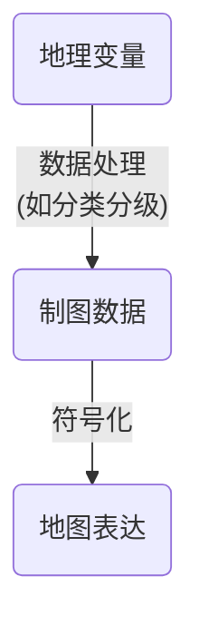

# 2 地图数据源

## 地图变量与制图数据

### 基本概念

- 地理实体：自然界现象和社会经济事件中不能再分割的单元（概括性、相对性）；可塑性面积单元问题（modifiable areal unit problem）
- 地理变量：定性或定量描述地理现象的数据即构成地理变量
- 制图数据：地理变量用于制图时，这些变量就转化成了制图数据

绘制地图的实质是研究表达各种地理变量的符号和图形在地图上的位置关系。

### 地图变量

#### 按性质划分地理变量

- 空间数据：构成地理现象的空间形状、大小、分布特征，确定地理事物的空间位置
  - 空间定位：确定位置
  - 空间量度：长度、面积、体积等
  - 空间结构：物体之间的相互关系
  - 空间聚合：空间数据与专题数据的结合
- 属性数据：定性或定量地描述地理现象的性质和特征
  - 表示地理实体的本质特性，如河流的名称、性质等
  - 表述地理实体的数量特性。如人口数、流量等

#### 按几何类型划分地理变量

- 点位数据：以单独的位置存在的事物，在地图上以点（坐标）来描述
  - 具体的点位数据：地理现象本身以点状特征存在，如测量控制点
  - 抽象的点位数据：地理现象本身是面状的，但由于比例尺的缩小，面状现象只能用不依比例尺的点状符号表达，如居民地
- 线状数据：以线状存在的事物，用坐标串来描述，具有一维特征
  - 具体的线状数据：地理现象本身以线状特征存在，如行政区界线
  - 抽象的线状数据：地理现象本身是面状的，但由于比例尺的缩小，面状现象只能用不依比例尺的点状符号表达，如河流、道路等
- 面状数据：描述区域范围的数据，用封闭的线性数据描述，具有二维特征
  - 大部分的地理现象在实地都具有面状分布特征，而表现在地图上则要受地图比例尺的限制。在较大比例尺地图上，许多地理现象都可以依比例尺表达，随着比例尺的缩小，能够依比例尺表达的地理现象会逐渐减少
- 体积数据：在面积数据的基础上加上第三维的值，有三维特征
  - 具体实体：晕渲表达的地貌、土石方、降水量等
  - 抽象概念：城市人口、国民生产总值等

### 地理变量组织表达

| 几何类型 | 矢量表达           | 栅格表达             |
| -------- | ------------------ | -------------------- |
| 点       | 一对 $(x,y)$ 表示  | 中心点像元表示       |
| 线       | $(x,y)$ 坐标串表示 | 中轴线上像元集合表示 |
| 面       | 坐标串表示轮廓范围 | 所覆盖的像元集合表示 |

## 制图数据源

地图数据采集任务：将上述多种类型的数据源，经过集成、验证、修改、编辑等处理，形成符合地图制作与应用需求的地图数据。

制图数据源包括：

- 实测数据：工程测量、手持 GNSS 接收器、移动测量车等
- 地图资料：已有的地图资料数字化形成数据库
- 影像资料：卫星像片、航空像片、地面摄影像片等
- 统计资料与文献资料：统计年鉴、地理考察资料、区划资料与政府文告、报刊消息、地理学文献等
- 新型制图数据源：GNSS、RFID、手机、IoT、视频监控等

提供制图数据的部门：

- 行政部门：国土局、测绘局、规划局、民政户籍、房管住宅、交通局、统计局、电力规划部门等
- 企业部门：社交媒体、电商平台、快递物流、共享出行、精准农业、外卖送餐等

## 坐标转换

确定位置 → 空间属性和序列（几何信息集成融合）→ **空间数据**

- 几何纠正：解决数字化过程引起的变形误差
- 坐标系转换：解决设备坐标系间以及与用户坐标系间的不一致
- 投影变换：解决地理坐标到平面坐标转换问题

### 几何纠正与坐标系转换

基本变换类型包括：

- 旋转：$\begin{cases}x=x_0\cos\alpha-y_0\sin\alpha\\y=x_0\sin\alpha+y_0\cos\alpha\end{cases}$
- 平移：$\begin{cases}x=x_0+D_x\\y=y_0+D_y\end{cases}$
- 缩放：$\begin{cases}x=S_xx_0\\y=S_xy_0\end{cases}$

综合上述三种基本变换可得到仿射变换模型：

$$
\begin{gathered}
\begin{cases}
x=a_0+m\cos\alpha\cdot x_0+n\sin\alpha\cdot y_0\\
y=b_0+m\sin\alpha\cdot x_0+n\cos\alpha\cdot y_0
\end{cases} \\
\Rightarrow\begin{cases}
x=a_0+a_1x_0+a_2y_0 \\
y=b_0+b_1x_0+b_2y_0
\end{cases}
\end{gathered}
$$

仿射变换的特性：

- 直线变换后仍为直线
- 平行线变换后仍为平行线
- 不同方向上的长度比发生变化

求解上式中的 6 个未知数，需不在一直线上的 3 对已知控制点，由于误差，需多余观测，所以，用于图幅定向至少需要 4 对控制点。

针对扫描地图，给定图幅顶角 4 个点作为控制点，通过仿射变换进行几何纠正，也称为「坐标配准」。

### 投影变换

- 解析变换法

  - 正解变换法（直接变换法）：$\boxed{x,y}\to\boxed{X,Y}$
  - 反解变换法（间接变换法）：$\boxed{x,y}\to\boxed{\phi,\lambda}\to\boxed{X,Y}$

- 数值变换法：利用若干同名点，采用插值法、有限差分法或多项式逼近的方法来建立两投影间的变换关系式

- 数值解析变换法：已知新投影的公式，但不知原投影的公式时，可先通过数值变换求出原投影点的地理坐标 $\phi,\lambda$，然后代入新投影公式中，求出新投影点的坐标，即
  $$
  \boxed{x,y}\xrightarrow {数值变换}\boxed{\phi,\lambda}\xrightarrow {解析变换}\boxed{X,Y}
  $$

## 分类分级

数据处理 → 将数据分类分级 → **属性数据**

分类分级：是帮助人们揭示空间关系的一种方法，它的目的是为了在地图上表达制图物体和对象。

### 量表系统

地理数据存在着**精确度**的问题。有概略的数据，也有详细的数据。数据的详细与否取决于数据获取的目的、手段以及数据处理的进一步目的。数据的精确度可以用**量表系统**来衡量。

四种量表的有序排列：

1. 定名量表：**定性区分属性**，反映地理现象的质量特征（如名称、类别等）
2. 顺序量表：按某种标志将制图物体或现象排序，反映相对的等级概念（如大、中、小等），**有等级无数量**）
3. 间距量表：利用某种单位对顺序增加距离信息，**等级差别大小、分级+距离，不能获得要素的具体数量**
4. 比率量表：**绝对数量、绝对零点和绝对量**，完整的定量化方法，可描述客体的绝对量、可四则运算

量表的精度顺序：

$$
\large{
  \underset{\substack{\downarrow\\区分定性特征}}{\boxed{定名量表}}
 <\underset{\substack{\downarrow\\区分定量特征}}{\boxed{顺序量表}}
 <\underset{\substack{\downarrow\\区分定量等级}}{\boxed{间隔量表}}
 <\underset{\substack{\downarrow\\区分数量大小}}{\boxed{比率量表}}
}
$$

量表数据的转化：比率量表 → 间隔量表 → 顺序量表 → 定名量表

### 分级与分级处理

**分类处理**：将具有**共同的属性或特征**的事物或现象**归并**在一起，而把不同属性或特征的事物或现象分开的过程。

分类的基本原则是：科学性、系统性、可扩性、实用性、兼容性、稳定性、灵活性

**分级处理**：对事物或现象的**数量（或特征）进行等级的划分**，主要过程为分级数和分级界线的确定。

多种特征综合分级（包括定性特征）：

- 道路（建设材料、路宽、通行量）：高速公路、国道、省道……
- 城市（人口、GDP、政治文化）：一线、二线、三线……

数据的分级方法：

- 等间隔分级
- 按某一速度（恒定速度或加速度）递增 / 递减
- 按某种变量系统确定分级间隔，如自然裂点法等
- 模糊聚类法分级
- 云模型
- ……

**不论采用哪种方法分级，分级结果应能够反映区域地理特征**。

### 数据分层

数据分层是地图数据按属性性质分类的结果，即将某种属性数据**相同或相近的实体数据组织为一个数据层**（也称为图层）。

- 专题分层：每个图层对应一个专题，包含某一种或某一类数据，如地貌层、水系层、道路层、居民地层等
- 时间序列分层：把不同时间或不同时期的数据作为一个数据层
- 地面垂直高度分层：把不高度的数据作为一个数据层

数据分层的好处：

- 便于数据管理：地图数据分为若干层后，对所有地图数据的管理就简化为对各子层的管理，而一个数据层的数据结构比较单一，数据量相对较小，管理起来就相对简单
- 利于数据查询：地图数据查询时，不需要对所有数据进行查询，只需要对某一层数据进行查询即可，可加快查询速度
- 增强地图可视化表达灵活性：分层后，可以选择需要显示的图层，增加了图形显示的灵活性
- 有利于组织数据进行空间分析：对不同数据层进行叠加，可进行各种目的的空间分析

### 数据编码

在属性数据中，有一部分是与几何数据的表示密切有关的。例如，道路的等级、类型等，决定着道路符号的形状、色彩、尺寸等。在 GIS 中，通常把这部分属性数据用编码的形式表示，并与几何数据一起管理起来。

- **编码**：是指确定属性数据的代码的方法和过程。
- **代码**：是一个或一组有序的易于被计算机或人识别与处理的符号，是计算机鉴别和查找信息的主要依据和手段。

**编码的直接产物就是代码，而分类分级则是编码的基础**。

## 统计数据加工

动机：将有差异的数据统一到同一标准中，具有可比性。

统计数据可能来源于不同的部门、不同的时间，这就可能造成统计单位和统计时间的不一致，这样的数据不具可比性。制图前需要对这些数据进行预处理。对于统计单位不一致的数据，需要将它们换算成一致的单位，或者将它们转化成无量纲的形式，即数据的标准化。

- 平均值：最常见的一种派生数据，平均值又有算术平均值、加权平均值、中位数和众数四种。
  - 算术平均值 $\bar X=\sum x_i/n$：如粮食亩产、人均收入、人均占有耕地、多年平均气温等
  - 加权平均值 $\bar X=\sum a_ix_i/\sum a_i$：如用各乡平均亩产计算全县的平均亩产等问题
- 比率：指两个数之比派生的定量数据
  - 比率 $x=n_a/n_b$：两类物体或现象的数值之比，如牲猪的出栏头数和存栏头数之比
  - 比例 $x=n_a/N$：某类物体或现象的数值与其总数之比，如全年降水天数同全年天数之比
  - 百分比：将上述比例换算成百分率的形式即为百分比
- 密度 $D=N/A$：一种特殊的比率形式，通常指单位面积内的平均值，反映离散现象的密集程度。例如人口密度、河网密度、每千人拥有的医生数和病床数、城市居民拥有的住房面积和绿地面积等

## 制图数据质量控制

制图数据质量五大方面：

- 位置（几何）精度：如数学基础、平面精度、高程精度等，用以描述几何数据的误差
- 属性精度：如要素分类的正确性、属性编码的正确性、注记的正确性等，用以反映属性数据的质量
- 完备性：如数据分类的完备性、实体类型的完备性、属性数据的完备性、注记的完整性，数据层完整性，检验完整性等
- 现势性：如数据的采集时间、数据的更新时间等
- 逻辑一致性：如多边形的闭合精度、结点匹配精度、拓扑关系的正确性等，由几何或属性误差也会引起逻辑误差

各阶段可能的误差来源：

- 数据采集：实测误差，地图制图误差（制作地图的每一过程都有误差），航测遥感数据分析误差（获取、判读、转换、人工判读与识别要素误差）
- 数据输入：数字化过程中操作员和设备造成的误差，某些地理属性没有明显边界引起的误差（地类界）
- 数据存贮：数字存贮有效位不能满足（由计算机字长引起，单精度、双精度类型）、空间精度不能满足
- 数据操作：
  - 类别间的不明确、边界误差（不规则数据分类方法引起）
  - 多层数据叠加误差、多边形叠加产生的裂缝（无意义多边形）
  - 各种内插引起的误差
- 数据输出：比例尺误差、输出设备误差、媒质不稳定（如图纸伸缩）
- 成果使用：用户错误理解信息、不正确使用信息

## 杂项

4D 产品：

- 数字线划图 DLG
- 数字正射影像图 DOM
- 数字高程模型 DEM
- 数字栅格图 DRG

5D = 4D + DMI (Digital Measurable Image)
实景可量测影像
