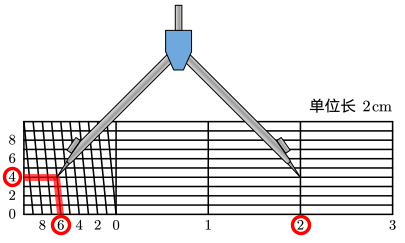

# 3 地图数学基础

## 地球的形状与大小

- **自然表面**：高低起伏，不规则
- **物理表面**（大地水准面）：小起伏，不够规则
  - 铅垂线：重力方向线（地心引力+离心力），外业测量的基准线
  - 水准面：平静的水面向陆地延伸形成的曲面，与铅垂线垂直，是一个**重力等位面**，有无数个
  - 大地水准面：与平均海水面重合的水准面，外业测量的基准面，不规则、无简单的数学模型
  - 似大地水准面：从地面点沿**正常重力线**量取**正常高**所得端点构成的封闭曲面
    - 严格说不是水准面，但接近于水准面，是用于计算的辅助面
    - 与大地水准面不完全吻合，差值为正常高与正高之差

- **数学表面**（地球椭球面）：旋转椭球体面，规则，模型简单
  - 是一个**规则**的数学面
  - 是**测量计算**的基准面
  - 地球椭球面的确立，标志着**测量坐标系**的建立

比例尺大于 1:100 万时使用旋转椭球体，小于 1:500 万时可以使用圆球体代替。

## 地球坐标系

经纬度：

- 天文经纬度（**大地水准面**上的位置）
  - 天文经度：天顶子午面、格林尼治天顶子午面间的二面角
  - 天文纬度：**铅垂线**与赤道夹角
- 大地经纬度（**参考椭球面**上的位置）
  - 大地经度：参考椭球面某点大地子午面与本初子午面间的二面角
  - 大地纬度：参考椭球面某点**法线**与赤道平面的夹角
- 地心经纬度（**地球椭球体中心**为基点）
  - 地心经度：同大地经度
  - 地心纬度：**参考椭球面**上某点和**椭球中心**连线与赤道面间的夹角

在地图学中，用**大地经纬度**定义地理坐标。

中国先后采用的坐标系：

- 1954 北京坐标系：克拉索夫斯基椭球，大地坐标原点在北京
- 1980 西安坐标系：1975 IUGG 椭球，大地坐标原点在陕西泾阳
- 2000 国家大地坐标系：CGCS2000 椭球，地心坐标系

## 地图比例尺

地图比例尺的含义：

- 小区域：地图上一直线段长度与地面相应直线水平投影长度之比

  $$
  \frac dD=\frac1M
  $$

- 大区域：对地球半径缩小的比率

  - 主比例尺：在投影面上无长度变形处的比例尺
  - 局部比例尺：在投影面上有长度变形处的比例尺

地图比例尺的表示：

- 数字比例尺：$1:1\,000$，$1/500$

- 文字比例尺：`百万分之一`

- 图解比例尺

  - 直线比例尺

    

  - 斜分比例尺

    

  - 复式比例尺

    

> 斜分比例尺的读数：使用圆规在图面上量取线段长，再放置在斜分比例尺上。
>
> 
>
> 上图的读数是 2.64 单位。

尺度：空间信息被观测、表示、分析、传输的详细程度

- 传统制图——比例尺
- 数字制图——多尺度

数字制图的资料收集注重比例尺的精度，可以生成多级别比例尺的地图

## 地图投影

### 地图投影的概念

地图投影：在地球椭球面和平面之间建立点与点之间函数关系的数学方法

- 解决地球曲面与地图平面之间的矛盾，地图投影变形是**不可避免**的
- 地图投影的**本质**就是在**球面点与平面点之间建立起一一对应的函数**（定义）关系
- 利用微分椭圆研究地图投影变形，**长度变形**是所有投影中都存在的**最基本**的变形，它**制约**着角度变形与面积变形。

### 投影变形的描述

变形椭圆（微分椭圆）：地面上的微分圆，面积小到可以忽略地球曲面影响。投影到平面研究变化情况。

底索定律：每一点至少有一对**正交方向**，投影后仍正交。

主方向：投影后仍然保持正交的一对线的方向，长度比为极值、对应变形椭圆长短半轴。

三种变形：

- 长度比 / 长度变形 $m$：是**所有投影上都存在的最基本的变形**，它制约着角度变形和面积变形

  $$
  \mu=\frac{r'}r=\sqrt{a^2\cos^2\alpha+b^2\sin^2\alpha}
  $$
  长度比随位置和方向而变化。同一点上最大长度比 $a$ 和最小长度比 $b$，对应变形椭圆的长短半轴

- 角度变形 $u=\alpha-\alpha'$，当 $\alpha+\alpha'=90^\circ$ 时，角度变形最大

  - 最大角度变形 $\omega$：$\sin(\omega/2)=(a-b)/(a+b)$

- 面积比 $p=m_1m_2=ab$，面积比随位置而变化

根据**等变形线**选择合适的投影方法。

- 标准点：地图上**没有任何变形的点**；
- 标准线：地图上没有任何变形的线；
- 等变形线：**变形值相等的各点连线**，绘于经纬线网格内，表示变形分布。

### 地图投影方法

地图投影方法按构成方法分为：

- 几何透视法：根据透视几何原理，主要包括球心、球面与正射投影 / 方位投影、圆柱投影、圆锥投影，几何透视投影无法将全球投影下来
- 非几何投影：在几何投影的基础上，根据特定要求，通过数学解析方法得到投影函数（投影公式）
- 数学分析法
  - 等角（$\omega=0$，$a=b$，$m=n$，交通图、洋流图、风向图）
  - 等积（$P=ab=1$，自然/社会经济地图）
  - 任意投影（等距）

常用投影方法：

- （正轴、横轴、斜轴）方位投影
- （正轴、横轴）圆柱投影
- 正轴圆锥投影、伪投影、多圆锥投影

经圈为**垂直圈**，纬线圈为**等高圈**；投影时还会涉及新极点和新轴。

- 方位投影：等高圈投影为**同心圆**，垂直圈投影为**同心圆半径**；垂直圈间夹角**与经差相等**，圆心为投影中心。
- 性质：投影前后，从投影中心到任一点的**方位角保持不变**。
- 标准点/线：切点/割线。等变形线为**同心圆**。
- 球心投影：任意投影，**大圆为直线**（大圆航线）。
- 球面投影：等角投影，大圆和小圆投影后仍为圆（射程半径、卫星覆盖）。
- 正射投影：标准线为等高圈（天体图）。
- 圆柱投影：纬线为**平行直线**；经线为垂直于纬线的**平行直线**；经线间隔**与经差成比例**。标准线为赤道。
- 墨卡托投影：**等角投影**，正轴等角切圆柱投影；**等角航线投影为直线**，面积比为角度比的平方（世界时区图、**航海图、航空图**）。
- UTM 投影：中央经线长度比为 0.9996，通用横轴墨卡托投影（横轴**等角**割圆柱投影）。
- 高斯—克吕格投影：中央经线、赤道为直线，横轴**等角**切圆柱投影（我国基本地形图）。
- 圆锥投影：纬线投影为**同心圆弧**，经线投影为**同心圆弧半径**；两经线间夹角**小于经差且与经差成比例**。（方位投影、圆柱投影是圆锥投影的特例。）

圆锥投影的等变形线为同心圆弧；标准纬线向高纬的变形速度大于向低纬。

### 地图投影选择

根据等变形线选择地图投影方法，主要考虑**地图内容与用途、制图区域形状与位置**。

- **地理位置决定**地图投影的种类；**区域形状制约**地图投影的选择；**范围大小影响**地图投影的选择。
- **正轴方位投影**：南北两极；**横轴方位投影**：东西半球；**斜轴等积投影**：水陆半球/政区；**斜轴等距方位投影**：航空图。
- **正圆柱投影**：适合制作**沿纬线延伸**地区的地图，但不适合制作**高纬度地区**的地图（变形大）。
- **圆锥投影**：适合制作**沿纬线延伸的中纬度地区**地图。
- 极地：正轴方位投影；赤道：横轴方位投影/正轴圆柱投影；中纬度：正轴圆锥投影/斜轴方位投影。
- 南北向延伸：多圆锥投影。

地图投影判断：经纬格网、制图区域位置。

地图投影变换：**解析变换**（**反解 bl/正解、多项式建模**）、**数值变换**。

## 地图比例尺

- 主比例尺、局部比例尺、变比例尺。
- 随数字地图出现的无级别比例尺与多比例尺。
- **主比例尺**：投影面上**无长度变形**处的比例尺（分析地面实际缩小程度）；**局部比例尺**：投影面上有长度变形处的比例尺（反映地图**投影变形**大小、规律、性质）。
- 数字比例尺（1∶5000）、文字比例尺（百万分之一）、图解比例尺（**直线比例尺、斜分比例尺、复式比例尺**）。
- **变比例尺**：**有效利用图面、保密**。
- **多比例尺/多尺度**：数字制图。

## 地图分幅

分幅编号的目的：快速**查找/拼接地图**、控制**投影误差变形小**、便于**制作和使用**；磁盘容量有限，**局部维护/处理快捷**。

### 思考题

- 对地球的三级逼近：自然表面、物理表面（大地水准面）、数学表面（旋转椭球体）。
- 地图学采用何种地理坐标系：大地经纬度地理坐标系（小比例尺：地心）。
