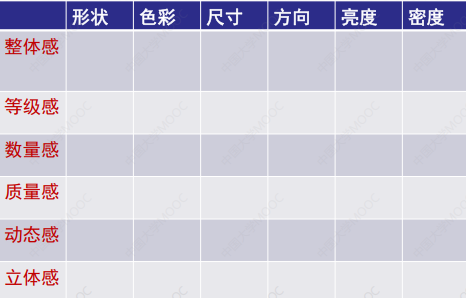

# 3 地图符号

## 地图符号概述

理解地图符号的定义、功能及其分类。

- **定义**：地图符号表示要素**空间位置、大小及其质量**的特定**图解记号或文字**，是地图表示**实际地物**的基本手段。
- 地图符号系统：**图形符号、色彩、注记**。
- 地图符号分类：按空间分布状态分为点状、线状、面状、体状；按比例关系分为不依比例符号/点、半依比例符号/线、依比例符号/线；按抽象程度分为集合符号/正形符号、象形符号/侧形符号、真形符号/象征符号；按特征量度分为定性、定级、定量；按维数分为 2D、2.5D、3D；还可按动态效果分类。
- 地图符号功能：精确地表达地理信息空间关系、抽象概括、形象化表达/传递信息、艺术科学性。
- 地图符号特征：抽象性、约定性（相同符号代表不同地物/国标）、等价变换、系统性。

## 地图符号的视觉变量与视觉感受

视觉变量（引起**视觉差别**最基本的**图形因素**）有 **6** 种：**形状**（注：**线面符号本身不是**）、**尺寸、色彩**（最活跃，见下）、**方向**（点状符号本身的方向/线面符号为元素方向）、**亮度、密度**（纹理、结构）。

视觉感受：色彩心理感受、图形心理感受（质量感、等级感、数量感）。

？？？？？

## 地图色彩

- 色彩三属性：**色相—质量**、**纯度（饱和度，深浅/鲜艳程度）—数量**、**亮度（明暗/黑白程度）—等级**。
- 三原色、RGB 色彩空间、CMYK 色彩空间。
- **红+绿=黄 Y；红+蓝=品 M；绿+蓝=青 C；CMYK**。
- 冷暖：长波—暖色、短波—冷色。
- 空间：前进—暖色/亮/饱和，后退—冷色/暗/不饱和。

## 地图注记

地图注记的作用：为什么没有注记的地图称为哑图？

地图注记是地图上的**文字说明**，对地图符号起到了**补充**作用。地图有了注记便有了**可阅读性和可翻译性**（哑图）。

- 作用：**标识制图对象**（名称注记）、**指示对象属性**（说明注记）、**说明符号含义**（注释）。

如何理解地名的政治功能？

地名档案可以**维护领土主权、保护版图完整**，是重要凭证。

地图注记的设计：**字体、字大、字色、字距、字向、字列**（水平、垂直、雁行、屈曲）/（面状主轴线排列）。

# 5 地图表达

概括与表达是地图的核心，生成客观世界的形象—符号模型。

## 地理信息的二维静态表达

**点状特征表达**：定点符号法。

定点符号法如何表达质量信息与数量信息？质量信息：（**形状/颜色主要**；**结构/方向次要**）；数量信息：**尺寸**（**准确、比例圆最精确：最稳定、单变量、视觉空间小**）/颜色主要；相对大小人为确定尺寸（非比率符号）、与数量面积成比例/精确（比率符号）。

- **绝对比率符号**：乘常数的关系、严密吻合，但数值差异不能过大/过小、相差悬殊。
- **条件比率符号**：符合某种函数关系。**心理比率法的视觉效果比绝对比率更重要**。
- **连续比率**：符号大小与实际数值一一对应；**分级比率**：**分级**设定代表性数值。

**线状特征表达**：精确定位（**道路、边界、地质构造，一般为静态**）、概略定位（**风向、洋流、迁徙**，一般为动态）；静态、动态如何表达质量信息与数量信息？

质量信息：形状、颜色。

数量信息：尺寸（宽度）、颜色（亮度、饱和度）。

**面状特征表达**：质量信息表达（**质底法、范围法**）、数量信息表达（**等值区域法、点值法、分区统计图表法**）。

- 质底法：连续分布（**无空白区域、不重叠**，如行政区、类型图）；范围法：离散分布（资源范围图）。
- 定量表达：颜色（**等值区域法**）/纹理/**点值法**/**分区统计图法**（**既反映质量特征又反映数量特征**）。

## 地理信息的三维静态表达（地貌）

- **写景法、晕滃法、等高线法**（首曲线、计曲线加粗、间曲线、助曲线）、**分层设色法**（高程）、**晕渲法**（阴影、表示立体）、**地貌虚拟**。
- 海洋要素表示：**海岸**（沿岸、潮浸、沿海、海岸线）、**海底地形**（等深线、理论深度基准面、自上而下计算）。
- 等高线法：平顶山等高线向下骤然变稠密；圆顶山等高线向下变密；尖顶……
- 等齐坡：等高线间隔相当；凸型坡：下密上疏；凹形坡：下疏上密；阶梯坡：相间。
- 影响晕渲效果的因素：**光源方位、入射角度、网格大小**。

## 地理信息的动态表达

- 动态视觉变量：**发生时长、变化速率、变化次序、节奏**（周期性）。
- 位置顺序（疫情扩散）、时间顺序（台风路径）。
