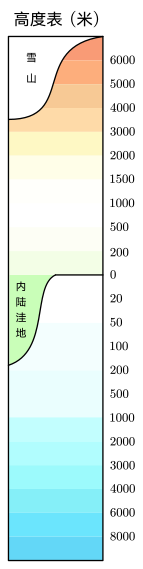

# 5 制图综合


## 制图综合的基本概念

### 制图综合的定义

当地图比例尺变小，同样的表达内容对应的表达空间变小。如果不做任何处理，地物会难以辨认。**地图的核心是概括和表达**，**制图综合**解决**复杂的现实**与**缩小简化**的地图模型之间的矛盾。

制图综合（地图综合）的定义：根据地图的用途、比例尺和制图区域的特点，以**概括、抽象**的形式反映制图对象的带有规律性的类型特征和典型特点，而将那些对于该图来说是**次要的、非本质的物体舍掉**。

制图综合的作用：

- 解决图面上缩小表象事物所产生的各种矛盾
- 构建多层次、多种级别的空间信息表达模型：人们对空间现象的认知表现为从总体到局部、从概略到细微、从重要到次要的层次顺序传统地图制图技术中
- 是空间认知的重要科学手段：城市规划设计，首先要对城市空间结构、设施分布、空间组团识别认识，只有通过制图综合抽象之后，才能把握主题特征，获得正确的空间认知感受
- 空间数据挖掘、空间分析的需要：通过抽象概括得到低分辨率下对空间的新的认知模型，并以图形形式表达空间的主体结构、分布模式、空间关系等内容，正是空间数据挖掘的内容
- 不同来源、不同领域地图数据集成的需要：点云数据、生态环境、基础设施、地形地貌等跨尺度异源数据集成融合

### 制图综合的实现

综合前后：**内容数量变化、结构形态变化**。

制图综合主要通过**概括**和**选取**的方法来实现的。

- 选取：是从大量的制图物体中选出较大的或较重要的物体表示在地图上，而舍弃次要的物体。
- 概括：是对制图物体的形状、数量和质量特征的化简，通过去掉轮廓形状的碎部代之以总的形状特征，缩减分类分级的数量，以减少制图物体间的差别。

概括和选取的区别和联系：

- 区别：选取针对单个或一类物体而言在新编图上应表示或舍去；概括是通过去掉制图物体总体中的细部及类别、等级的合并，更突出地反映物体的基本特征。
- 联系：概括通过选取来实现。

制图综合的原则：**详细性与清晰性、几何精确性与地理适应性**。

- 详细性与清晰性的对立统一：在**比例尺允许**条件下**尽可能多地表示**一些内容；在满足**用途要求**的前提下**层次分明、清晰易读**。
- 精确性（大比例尺）与地理适应性（小比例尺）：点位**坐标准确程度**，比例尺缩小、**精度降低**；空间分布/相互关系与实地**相似性程度**。

## 制图综合的影响因素

影响地图概括的客观因素：地图**用途和主题**（**宗旨、主导**）、地图**比例尺**（**方向、倾向**）、制图区域**地理特点**（**要素重要程度**）、资料质量、表示方法、制图者。

- 地图用途
  - 决定地图内容和表示方法的选择
  - 影响制图综合的方向和程度
- 地图比例尺
  - 影响制图综合程度
  - 影响制图对象的表示方法
  - 影响制图综合的方向
- 景观条件
  - 制约制图对象的重要程度
  - 决定制图综合原则
- 其他因素
  - 图解限制：地图符号的形状和尺寸
  - 数据质量：高质量的地图资料数据，给制图综合提供了可靠的基础和综合余地
  - 地图表示方法：不同的表示方法直接影响制图综合时对地图内容表示的详细程度

::: details $1:400$ 万《中国地形》教学挂图对比《中国地势图》

$1:400$ 万教学挂图《中国地形》局部


---

$1:400$ 万《中国地势图》局部


:::

## 制图综合的基本方法

```markmap
# 制图综合的基本方法
- 选取
  - 资格法
  - 定额法
- 概括
  - 形状概括
    - 删除
    - 夸大
    - 合并
    - 分割
  - 数量和质量概括
    - 删除
    - 合并
    - 移位
```

### 制图物体的选取

- 类别选取：整个一类信息全部舍弃或选取（地图内容设计的任务）
- 级别选取：舍弃某一级别信息（舍弃次要的、等级低的对象）

制图物体选取的顺序：

1. 主要 → 次要
2. 等级高 → 等级低；大 → 小
3. 整体 → 局部

制图物体的选取有**资格法**和**定额法**。

#### 资格法

- 概念：按照一定的数量标志和质量标志作为选取的标准（资格）而进行选取的方法。例：以某长度作为河流的选取标准、以某等级作为道路网的选取标准
- 选取标志
  - 数量标志：长度、面积、产值等
  - 质量标志：等级、品种、性质等
- 优缺点
  - 优点：标准明确，简单易行
  - 缺点
    - 一个标志不能全面衡量出物体的重要程度（如：小湖泊在不同的地区重要程度不同）
    - 同一资格无法预计选取后的地图容量

#### 定额法

- 概念：规定出单位面积内应选取的制图物体的数量。例：96 个 $/\operatorname {dm^2}$
- 优缺点
  - 优点：预计地图容量，保证地图具有相当丰富的内容而又不失去易读性
  - 缺点：无法保证在不同地区保留相同质量指标
  - 弥补措施：临界指标（高指标、低指标），调整不同区域内选取物体的质量标准，以及与相邻区域分布密度的逐渐过渡

### 形状概括

**删除**制图对象图形的**不重要的碎部**，**保留**和适当**扩大**其**重要的特征**，使制图对象构成更具有本质特性的明晰的轮廓。

- 删除：制图物体图形中的某些碎部，在比例尺缩小后无法清晰表示时应予以删除

  

- 夸大：为了显示和强调制图物体的形状特征，需要夸大一些本来按比例应当删除的碎部

  

- 合并：随着地图比例尺的缩小，制图物体的图形极其间隔小到不能详细区分时，可以采用合并同类细部的方法，来反映制图物体的主要特征

  

- 分割：单用合并，有时会歪曲制图物体的特征，常常需要辅之以分割的方法

  

### 数量和质量特征的概括

- 数量特征：指物体的长度、面积、高度、深度、坡度、密度等可以用数量表达的标志的特征。选取和形状概括都会导致数量特征变化，例如舍去的河流或小弯曲会导致河流总长减少、河网密度变化。
- 质量特征：指决定物体性质的特征。质量接近则为同类，使用同样符号。
  - 分类特征：如居民地、河流
  - 分级特征：如行政意义分级

比例尺缩小则类别、级别减少。

物体数量和质量特征的概括方法：

- 删除：整个删除某类标志。例如：不表示河流的通航性质
- 合并：详细分级合并成概略分级。例如：居民地 1 ~ 2 万和 2 ~ 5 万人口合并为 1 ~ 5 万

质量特征概括会引起分类分级缩减。

地图缩编时解决争位矛盾的方法：

- 舍弃：当符号定位发生矛盾时，特别是当同类符号碰到一起时，一般舍弃其中较低一个
- 移位
  - 双方移位：两者同等重要时，采用相对移位方法
  - 单方移位：两者重要程度不同时，符号之间保持正确的拓扑关系的情况下，移动级别低的

为什么要移位：保证地图内容各要素**总体结构的地理适应性**。

移位的基本要求：

1. 一般原则是**保证重要物体位置准确，移动次要物体**
   - 海、湖、大河流等大的水系物体与岸边地物发生矛盾时，海、湖等不位移
   - 河流、铁路与居民地矛盾时，河流、铁路位置不动
2. 特殊情况下，要考虑地区特点、各要素制约关系、图形特征、移位难易等条件
3. 相同要素不同等级地物间关系的处理：保持高一级道路不动，移动低一级的道路，或共边处理

移动后两符号间关系应能清晰表达且留有最小间距，间距通常为 $0.2\operatorname{mm}$。


## 制图综合的基本规律

### 图形最小尺寸

地图上的线划、几何图形、轮廓图形和弯曲等基本图形应当达到的最小尺寸。基本图形影响地图内容的详细程度、精确性。

- 线划
  - 单线划的粗细为 $0.08\sim0.1\operatorname{mm}$
  - 两条实线间的间隔为 $0.15\sim0.2\operatorname{mm}$
- 几何图形
  - 实心矩形的边长为 $0.3\sim0.4\operatorname{mm}$
  - 复杂轮廓的突出部位为 $0.3\operatorname{mm}$
  - 空心矩形的空白部分边长为 $0.4\sim0.5\operatorname{mm}$
  - 相邻实心图形的间隔为 $0.2 \operatorname{mm}$
- 轮廓符号
  - 实线轮廓的半径为 $0.4\sim0.5 \operatorname{mm}$
  - 点线轮廓的最小面积为 $2.5\sim3.2\operatorname{mm^2}$
- 弯曲图形的最小尺寸：弯曲图形的内径为 $0.4\operatorname{mm}$ 时，宽度需达到 $0.6\sim0.7\operatorname{mm}$。

### 地图载负量

由大比例尺地图综合变换为小比例尺地图过程中，地图内容的数量变化关系受客观规律的控制。

地图载负量是衡量地图内容多少的数量标志，是衡量地图表达到何种程度、表达多少合适的一个重要参量，是研究地图内容综合的直接依据。

为了使载负量的概念规格化，使其与图幅大小无关，从而便于进行比较，采用百分比或「每平方厘米中的数量」的形式表示，它往往带有平均性质。

```markmap
# 地图载负量
- 按量算方式分
  - 数值载负量
  - 面积载负量
- 按内容特性分
  - 符号载负量
  - 注记载负量
```

#### 数值载负量与面积载负量

- 数值载负量：指地图所表达的地理实体的个数，通常采用密度表示法
  - 点状地物 $P_点=n_点/f_G$：单位面积中地物的个数
  - 线状地物 $P_线=\sum l_线/f_G$：单位面积中的地物长度（密度系数）
  - 面状地物 $P_面=\sum f_面/f_G$：面积百分比
- 面积载负量 $P=\sum f/f_G$：指地图中符号和注记所占面积与图幅面积之比，通常以图面每平方厘米中符号和注记所占的面积来表达

两种载负量形式的比较：

|          | 数值载负量                                         | 面积载负量                                                   |
| -------- | -------------------------------------------------- | ------------------------------------------------------------ |
| 描述对象 | 面向 DLM，直接与地理实体关联，反映地物分布密集程度 | 面向 DCM，分析图面表达上的符号注记图形，反映图面被填充的程度 |
| 影响因素 | 地理实体的分布密度                                 | 除地理实体特征外，受符号、注记形式影响                       |

关系：数值载负量是面积载负量的实体化体现，是面积载负量的决定性因素；面积载负量是数值载负量的可视化体现，是导出数值载负量的可靠依据。

#### 地图载负量变化规律的表达模型

地图载负量变化规律的表达模型：为解决综合尺度变换中内容选取的「定量」问题，需要对地图载负量变化进行描述表达，以实现 $E_{初始}\to E_新$ 的地物数量变换。其中有两种思路：

- 总结归纳：对已有系列比例尺地图数据归纳总结，得到典型区域的各要素类目标的载负量值。如：$1:25$ 万地形图中密区大中型居民地保持 60 ~ 80 个 $/\operatorname {dm^2}$
- 数学模型：通过某种数学模型较为精确地模拟地图载负量的变化规律。如：图解计算模型、回归模型、等比数列模型、开方根定律等

制图综合的开方根定律：

$$
n_2=n_1\sqrt{\frac{M_1}{M_2}}
$$

其中，原图比例尺为 $1/M_1$、包含 $n_1$ 个地物，新图比例尺为 $1/M_2$、包含 $n_2$ 个地物。

### 制图物体选取基本规律

- 制图物体的密度越大，其选取标准定得越低，但被舍弃目标的绝对数量越大
- 选取**遵守从主要到次要、从大到小的顺序**，在任何情况下舍去的都应是较小的、次要的目标，而把较大的、重要的目标保留在地图上，使地图能保持地区的基本面貌
- 物体密度系数损失的绝对值和相对量都应从高密度区向低密度区逐渐减少
- 在保持各密度区之间具有最小的辨认系数的前提下**保持各地区间的密度对比关系**

### 制图物体形状概括基本规律

- 舍去小于规定尺寸的弯曲，夸大特征弯曲，保持图形
  的基本特征
- 保持各线段上的曲折系数和单位长度上的弯曲个数的对比
- 保持弯曲图形的类型特征
- 保持制图对象的结构对比
- 保持面状物体的面积平衡

### 制图综合对地图精度的影响

- 编图过程中对图形移位而产生的精度误差
  - 保持要素间的地理适应性的移位：为了保持要素间的相互适应关系，相对次要的要素就要移位。 编图比例尺为 $1:100$ 万，公路旁的小居民地的移位就可能达到 $1.0 \operatorname{mm}$。当符号发生争位矛盾时，都要产生这样的移位
  - 为了强调某种特征而产生的移位：为了强调某种特征，有时要有意识地进行移位
- 形状概括产生的误差：长度变化、方向变化、轮廓图形改变

## 水系要素的制图综合

```markmap
# 水系要素的制图综合
- 海洋要素
  - 海岸线
  - 岛屿
  - 海底地貌
- 陆地水系
  - 河流
  - 湖泊
  - 水库
  - 渠网
  - 井、泉
```

### 海洋要素的综合

#### 海岸线综合

海岸线图形概括的基本过程：

1. 研究类型及图形特征
2. 找出关键点
3. 确定准确位置
4. 图形化简

海岸线图形概括的要求：

1. 保持海岸线平面图形的类型特征
   - 侵蚀海岸：岩质海岸，海岸港汊、岛屿多，岸线多，棱角弯曲
   - 堆积海岸：多具有低平的后滨，岸线多平滑
   - 生物海岸：珊瑚礁和红树林海岸
2. 保持各段海岸线间的曲折对比
3. 保持海陆面积对比
   - 海角上，删去小海湾 → 扩大陆地面积
   - 海湾中，删去小海角 → 扩大海部面积

#### 岛屿的综合

岛屿的形状概括：

- 大岛屿：同海岸线概括
- 小岛屿：突出形态特征
- 岛屿只取舍，不合并

岛屿的选取原则：

- 根据选取标准进行选取，如：$>0.5\operatorname{mm^2}$
- 根据重要意义进行选取，如：标志国家领土主权、重要航道上
- 根据分布范围和密度进行选取

#### 海底地貌的综合

水深注记的选取：

- 选取浅滩上、航道上最浅水深注记
- 选取标志航道特征的水深注记
- 选取反映海底坡度变化的水深注记
- 补充水深注记到必要密度

等深线勾绘：先判断地形的基本结构和走向，再内插。原则：判浅不判深

等深线的综合：

1. 等深线的选择：根据深度表进行
   - 浅海详细，深海概略
   - $-20\operatorname m$ 和 $-200\operatorname m$ 等深线必须选择
   - 对封闭等深线，浅海区海底洼地可舍去
   - 深水区小浅部应保留
2. 等深线的图形概括，原则：舍深扩浅

### 陆地水系综合

#### 河流的综合

河流的类型：平原地区的水网、山区的水网

河流选取标准的确定：将实地河网按密度进行分级，在不同密度区中确定相应选取标准

1.  量算制图区域的**河网密度**并进行分级
2.  根据数学方法确定各级的**定额指标**、**长度标准**和**间隔指标**

河流选取的基本规律：

- 河网密度大的地区，其选取标准较低，但被舍去的河流条数较多，密度系数仍然较大。河网密度小的地区，舍去的河流条数较少。
- 选取遵守从主要到次要，从大到小的顺序，保持制图区域内河流的基本特征。
- 保持不同密度区的密度对比关系；
- 随着比例尺缩小，选取标准的上限逐渐增大。如：$1:10$ 万选取上限是 1.0 或 1.2，$1:100$ 万选取上限为 1.5 或更高

对低于选取标准的河流的处理：

- 小的河源河优先选取
- 构成河系类型特征和显示河网密度对比的小河流适当多选一些；
- 具有联系目标的小河流，如贯通城市，联系湖泊、井、泉，喀斯特伏流河段，界河，独流入海的小河，干旱、半干旱地区的小河及消失河段，联系重要灌溉系统的河段应尽可能表示；
- 舍去那些长度虽然大于选取标准，但河流之间的间隔小于最小间隔尺寸的河流。

河流选取的基本步骤：选取主流 → 选取一级支流 → 二级…

河流的图形概括（目标）：舍去小弯曲、突出类型特征，同时保持各河段弯曲对比。

```markmap
# 河流弯曲形状
- 简单弯曲
  - 微弯曲
  - 钝角形弯曲
  - 近于半圆形弯曲
  - 套形弯曲
  - 菌形弯曲
- 复杂弯曲：在一级的套形或菌形弯曲上发育成的复合弯曲
```

河流图形概括的基本原则：

- 舍弃小的弯曲，保持弯曲的基本形状（简单/复杂弯曲）
- 保持河流弯曲的特征转折点
- 保持不同河段弯曲程度的对比
- 保持河流长度不过分缩短

#### 湖泊的综合

湖泊的选取：对成群的湖泊而言，只能进行取舍，不能合并。常用选取标准：$0.5\sim1\operatorname {mm^2}$

1. 选择大于或等于选取标准的湖泊
2. 选取那些有特殊意义的小于标准的小湖泊，并夸大表示（或改用点符号表示）。如有经济价值的小湖泊（矿泉湖），干旱地区的小湖等。
3. 注意反映湖泊的分布特征和密度对比。

湖泊的图形概括：

1. 删除岸线上的小弯曲，适当夸大局部的弯曲特征，保持湖泊平面图形的基本特征；
2. 保持湖泊与陆地的面积对比；
3. 保持湖泊的平面特征及与其他要素的关系（如与等高线的关系）。

#### 水库的综合

- 真形水库的综合
  - 选取 + 形状概括
  - 选取标准：库容量、注记大小、面积
  - 形状概括：注意与其他要素的协调（等高线）
- 记号性水库的综合

#### 渠网的综合

主要表现在取舍方面，少有图形概括。

- 选取步骤：确定选取指标（同河流）→ 确定间隔指标（$2.5\sim3.0\operatorname{mm}$）
- 选取原则：从主要到次要
  - 由主要渠道构成渠网的骨架，再选取联通性好的支渠；
  - 注意渠间距和各局部区域的密度对比关系

#### 井、泉的选取

井、泉的综合只表现在取舍方面。

1. 居民地内部的井、泉和水网地区的井、泉
   - 大于 $1:2.5$ 万的地图上部分表示
   - 人烟稀少的荒漠地区尽可能详细表示
2. 选取水量大的，有特殊性质的（如温泉、矿泉），处于重要位置上如路口或路边的井、泉
3. 反映井、泉的分布特征
4. 反映各地区间井、泉的密度对比关系

## 居民地的制图综合

```markmap
# 居民地构成元素
- 建筑物（房屋）
  - 依比例
  - 半依比例
  - 不依比例
- 街道
  - 主要街道
  - 次要街道
- 街区
  - 密集街区
  - 稀疏街区
- 名称注记
```

```markmap
# 居民地类型
- 城镇式居民地
  - 建筑密集街区
  - 建筑稀疏街区
- 农村式居民地
  - 街区式农村居民地
  - 散列式农村居民地
    - 团状
    - 列状
  - 分散式农村居民地
  - 特殊式农村居民地
```

### 居民地的形状概括

#### 城市居民地的形状概括

城市居民地平面图形化简原则：

1. 正确反映居民地的内部通行情况。通行情况：街道、铁路和水上交通等，重点是街道。随着比例尺缩小，需要对街道取舍

   - 首先应选取主要街道，再选取条件好的次要街道
   - 连贯性强，对城镇平面图形结构有较大影响的街道
   - 与公路特别是两端都与公路连接的街道
   - 与车站、码头、机场及其他重要目标相连接的街道
   - 根据街道网的密度、形状等特征的要求补充其他的街道

   > [!warning]
   >
   > - 新编地图的主、次街道需按照新图符号尺寸的要求绘制。同等级的街道宽度保持一致。
   > - 对资料图上难以判断主次的街道，做降级处理（就低不就高）。
   > - 一般情况下，要求主要街道的中心线位置准确，只有在与相邻的铁路、江河、海岸等要素发生争位矛盾时，才允许移位主要街道。

2. 正确反映街区平面图形的特征：舍去次要街道、合并街区的同时，应注意不改变原来街区的纵横方向

   

3. 正确反映街道密度和街区大小的对比：地形图编绘规范中，对街区面积的概括程度有明确规定

4. 正确反映建筑面积与非建筑面积的对比：街区类型不同，概括手法也不同

   - 建筑密集街区：合并为主、删除为辅

     - 合并街区及间距小于 $0.2\operatorname {mm}$ 的建筑物

     - 删除远离建筑区的细小独立建筑或凹凸部

     - 要求使并入建筑地段的空白部分与建筑地段被删除面积大体相等，以保持街区内建筑面积与非建筑面积的正确对比

       

   - 建筑稀疏街区：选取、合并、删除进行概括（选取或删除独立建筑物，合并局部密集建筑物）

     

     

5. 正确反映居民地的外部轮廓形状

   - 用平面图形表示居民地的内部结构和外围轮廓
   - 只用外围轮廓线表示居民地的形状

随着比例尺的缩小，图上已无法表示居民地的内部结构，只能用外围轮廓线表示居民地的形状。此时要注意处理居民地轮廓图形与道路、河流、地形要素的关系。轮廓线一般以街区的外边线或外缘街道线为准。凸凹部分小于 $0.5\operatorname{mm^2}$ 可舍去。轮廓外围的零散建筑物可不表示。

城镇式居民地形状概括的一般程序：

1. 选取居民地内部的方位物
2. 选取铁路、车站及主要街道
3. 选取次要街道
4. 概括街区内部结构
5. 概括居民地外部轮廓形状
6. 填绘其他说明符号

#### 农村居民地的形状概括

- 街区式农村居民地的概括：形状概括原则跟城镇式居民地相同
  - 密集街区：舍去次要街道，合并街区，区分主次街道
  - 稀疏街区：舍去次要街道，合并街区；对独立房屋进行取舍
  - 混合型：根据各部分的固有特征采用相应的办法进行化简
- 散列式农村居民地的概括
  - 特点：不依比例独立房屋（散而有界、小而有名）；核心有少量依比例的街区建筑
  - 方法：对独立房屋选取
  - 综合原则
    1. 选取位于重要位置上的独立房屋
    2. 选取反映居民地范围和形状特征的独立房屋
    3. 选取反映居民地内部分布密度对比的独立房屋

### 用圈形符号表示居民地

明显性：面积、结构、视觉黑度和颜色等

圈形符号定位原则：

1. 平面图形结构呈面状均匀分布时，圈形符号定位于图形的中心；
2. 居民地由街区和外围的独立房屋组成时，圈形符号配置在街区图形的中心；
3. 居民地图形由有街道结构和部分无街道结构的图形组成时，圈形符号配置在有街道结构部位的中心；
4. 散列式居民地圈形符号配置在房屋较集中部位的中心；
5. 对于分散式居民地首先应判明其范围圈形符号配置在注记所指的主体位置的中心。

圈形符号和其他要素的关系处理：

- 相接：当线状要素通过居民地时，圈形符号的中心配置在线状符 号的中心线上
- 相切：当居民地紧靠在线状要素的一侧时，表现为相切关系，圈形符号切于线状符号的一侧
- 相离：居民地实际图形同线状物体离开一段距离，在地图上两种符号要离开 0.2 mm 以上


### 居民地的选取

选取指标的确定：

- 对整个制图区域进行密度分区
- 确定各密度区居民地的选取指标（数量指标）
  - 图解法：根据制图经验，在现有地图的基础上初步确定各密度区的选取数量，并通过局部的综合样图试验，调整并确定选取指标。
  - 解析法：利用数学模型确定居民地的选取指标。
    - 单相关模型 $Y=ax^b$：$Y$ 为选取数量，$x$ 为资料图居民地数量，$a,b$ 为待定参数。根据统计数据拟合回归方程，从中求出参数 $a$ 和 $b$。
    - 负相关模型 $Y=b_0x_1^{b_1}x_2^{b_2}$：$Y$ 为选取数量，$x_1,x_2$ 为影像居民地选取的两个因素，$b_0,b_1,b_2$ 为待定参数，根据统计数据拟合回归方程求解。

  - 开方根规律：$K=\sqrt{M_A/M_F}$，其中 $K$ 为选取率，$M_A$ 为资料图比例尺分母，$M_F$ 为新编图比例尺分母

- 确定一个选取资格（全取线），如：乡镇以上居民地全取。

居民地选取的一般原则：

- 优先选取具有重要性意义的居民地：按行政等级、人口数、图形面积、政治、军事、历史文化等
- 保持居民地的分布特征：分布密度、分布中心、分布轴线、分布范围等

选取方法：首先根据居民地的选取资格将资格以上的居民地全选，然后再根据选取的数量指标和选取原则在资格线以下的居民地中进行补充选取，直到达到选取定额。

### 居民地的名称注记

居民地名称注记的选取:

1. 位于城市郊区并和城市连成一体的农村居民地可以选注名；
2. 当居民地成群分布，有分名也有总名时，在注出总名的条件下，分名可以选注；
3. 大居民地有正名和副名时副名可按规定选注。

居民地名称注记的定名、定级和配置：

1. 居民地的定名：以国家公布地名为主
2. 居民地名称注记的定级：确定字体、字大
3. 居民地名称注记的配置：不压盖同居民地联系的重要地物

## 交通网的制图综合

```markmap
# 交通网
- 陆地交通网
  - 铁路
  - 公路
  - 其他道路
  - 交通附属设施
- 水网交通线
- 空中交通线
```

### 陆地交通网

道路的分类和分级：

- 铁路
  - 按轨数分：单轨铁路、双轨铁路、多轨铁路
  - 按轨宽分：标准轨铁路、窄轨铁路
  - 按牵引方式分：电气化铁路、其他铁路
- 公路
  - 按通行能力分：高速公路、主要公路、普通公路、简易公路
  - 按综合标志分：国道、省道、县道、乡镇道路
  - 按交通部标准分：汽车专用路、一般公路
- 其他道路：大路、乡村路、小路、时令路

选取道路的一般原则：

1. 重要道路应优先选取

   例：等级高的道路；作为区域分界线的道路；通向国境线的道路；沙漠区通向水源的道路；穿越沙漠、沼泽的道路；通向车站、机场、港口、渡口、矿山、隘口等重要目标的道路。

2. 道路的取舍和居民地的取舍相适应

   - 居民地密度 → 道路网的密度
   - 居民地的等级 → 道路的等级
   - 居民地的分布特征 → 道路网的结构

3. 保持道路网平面图形的特征：道路的网状结构，其形状多取决于居民地、水系、地貌等的分布特征。在道路选取时，应**注意这些道路网的平面图形特征**。

4. 保持不同地区道路的密度对比：各种**不同的密度区采用不同的选取指标**，这样可以始终要保持密度对比关系

道路选取的方法：

- 铁路的选取：完整地选取全部铁路网，舍去一些通往厂矿的专用线、短小的支叉线和窄轨铁路等。
- 公路的选取：首先要选取高速公路、国道、省道、高等级公路等，选取连接省与省之间、重要城市之间的公路，然后再以各级行政中心为结点选取比较重要的公路，最后，为保持不同结点上公路条数的对比关系再作补充选取。
- 城市街道网的选取：根据道路的网眼大小、Stroke 等级指标进行选取

概括道路形状的方法：

- 删除：根据尺度标准给予删除从而减少道路上的弯曲个数，但是要**注意保持各路段的弯曲对比**
- 夸大具有特征的弯曲：对于具有特征意义的小弯曲，**特别是具有方位意义的特征弯曲**，应夸大表示
- 共线：为了保持其形状特征又不过多地使道路移位，可**采用共线的方法作特殊处理**
- 局部改变符号：**缩小符号宽度的尺寸**，另一种是**改变符号的图形**

道路附属物的选取：

- 火车站及其附属建筑物的选取
  - 选取主要的、等级高的车站，舍去次要车站
  - 对机车转盘、车档和有方位意义的信号灯、柱，在大比例尺地形图上，可择要选取

- 桥梁的选取：桥梁的选取应与道路的选取相一致。优先选取保持连接铁路、公路的桥梁。
- 道路附属建筑物的选取：隧道、明峒一般只选取，不合并。铁路、公路上的涵洞符号，只在大比例尺地形图上择要选取。双线河流上的车渡，应考虑选取（车）渡口。

### 水上交通线的制图综合

- 内河航线地形图上**只选取通航河段起讫点**，区分出定期通航和不定期通航的河段，选取相应的码头设施，可通行的水利工程设施及它们允许通过的吨位。
- 在双线河、湖泊及沿海港口中，图上**长度大于 $1\operatorname{mm}$ 的码头**应选取。
- 沿海和远洋航行的**海轮停泊港**口和对外开放的**内河港全部选取**，其他内河港择要选取。
- 海上航线由航海线和港口标志组成。选取近海航线沿大陆边缘用弧线绘出。选取远洋航线常按两点间的大圆航线方向描绘。在 $1:50$ 万地形图上灯光射程小于 10 海里，灯塔、灯桩择要选取，10 海里以上全部选取。

### 空中交通的制图综合

空中交通是指航空线路，用机场来表示的。在大比例尺地形图上，**选取民用、军用、军民合用机场**，符号配置在机场的适中位置上。同时**选取通往机场道路，机场的铁丝网、围墙等桓栅表示机场范围**。

机场内的跑道、油库、塔台等**反映机场性质的设施全部舍去**，如果有房屋的选取，用房屋符号表示。**选取民用机场名称，军用、军民合用机场场名称全部舍去**，用附近较大的城镇名称作为机场名称。在中小比例尺地形图上，**只选取民用机场**。

## 地貌的制图综合

大、中比例尺地图的地貌以反映“微观”的地貌形态为主要任务，强调精度；小比例尺地图的地貌以反映“宏观”的地貌形态为主，随着大量的碎部被删除，地貌的整体感不断加强。从这一角度说，地貌的综合过程又是一个地貌形态从“微观”向“宏观”方面转化的过程。

```markmap
# 地貌综合的过程
- 地貌形态缩小的过程
- 地形数据模型的综合过程
- 等高线的综合过程
```

等高线综合的具体体现：

- 等高距的变化 → 等高线的选取
- 等高线的形状特征变化 → 等高线的图形概括
- 地貌符号和高程注记的变化 → 符号和注记的选取

### 地形图上的等高距

等高距与地面倾斜角间的关系表示为
$$
\begin{aligned}
h&=A\tan \alpha \\
h&=\frac{aM}{1000}\tan\alpha
\end{aligned}
$$
式中：

- $h$：等高距（m）
- $\alpha$：地面倾斜角（坡度）
- $a$：等高线间隔（mm）
- $1/M$：地图比例尺

地形图的等高距与地图用途、比例尺、地貌类型（地面坡度）和图上两条等高线之间的最小间隔有关。

地形图上等高距的变化：大、中比例尺地形图上一般采用固定的等高距，等高距的变化导致了新编图上等高线的**选取**和**插绘**

| 比例尺     | 一般等高距 (m) | 扩大一倍的等高距 (m) |
| ---------- | -------------- | -------------------- |
| $1:1$ 万   | 2              |                      |
| $1:2.5$ 万 | 5              | 10                   |
| $1:5$ 万   | 10             | 20                   |
| $1:10$ 万  | 20             | 40                   |
| $1:25$ 万  | 50             | 100                  |
| $1:50$ 万  | 100            | 200                  |

小比例尺地图上常采用变高距，例如 1:100 万地图变距高度表：

| 高程 (m)      | 等高线 (m) |
| ------------- | ---------- |
| $< 200$       | 0, 50      |
| $200\sim3000$ | 200 的倍数 |
| $> 3000$      | 250 的倍数 |

等高线的并绘：当等高距确定后，若图中局部等高线过于密集，导致图上两相邻
等高线之间的间隔不足 $0.2\operatorname {mm}$ 时，需要采取「并绘」的方法处理。

补充等高线的应用：为了强调某些地貌特征。等高距的设计是在充分考虑地图用途、比例尺、地貌类型（地面坡度）和图上两条等高线之间的最小间隔等诸因素的基础上进行的，但设计结果仅能满足制图区域整体地貌形态的表达，对一些地貌碎部用基本等高线并不能很好地显示地表起伏形态，这时可增加补充等高线。间曲线取 $1/2$ 等高距，助曲线取 $1/4$ 等高距。

等高线的插绘：当新编图与资料图的等高距之间不是简单的整倍数关系时，就存在等高线的插绘问题。如 $1:10$ 万地形图等高距为 $20\operatorname m$，$1:25$ 万地形图等高距为 $50\operatorname m$，彼此之间不是简单的整倍数关系，这时 $50\operatorname m$ 的奇数倍等高线需要插绘。插绘等高线应根据地貌的斜坡、谷地、山顶和鞍部的形态特征进行。插绘过程中最好能参阅较大比例尺的地形图。根据资料图上的等高线图形判明坡形（平直坡、凸形坡和凹形坡），然后插绘。

- 平直坡 → 均匀插绘
- 凸形坡 → 插绘等高线向陡坡位移（向下位移）
- 凹形坡 → 插绘等高线向上位移

### 高度表

地貌高度表的设计：地形图的等高距是由国家测绘局统一制定的。当编制其它普通地理图时，需根据制图区域的地理环境和地貌特点制定地貌高度表，它是编图时选取等高线的依据。制图区域地貌特点的表现取决于高度表的设计。同一地区采用不同的高度表，地貌特征的表现各不相同。


高度表的构成：高度表一般由基本等高线和补充等高线排列组成，并构成基本单元和高层带。

设计地貌高度表的基本原则：

1. 综合考虑影响制图综合的基本因素
   1. 地图用途（对地貌表示的要求）
   2. 比例尺
   3. 制图区域地貌形态特点
   4. 资料情况（尽量避免或减少内插等高线）
2. 等高距的变化是渐进的，并适应地形变化的规律：世界范围内高程较低部分占绝大多数，这部分尽可能采用较小等高距
3. 高层带的分界线尽可能与地貌类型分界线吻合：我国地貌分类的高度分界线一般定为 $200\operatorname m$、$500\operatorname m$、$1000\operatorname m$、$3500\operatorname m$ 和 $5000\operatorname m$，它们分别为平原、丘陵、低山、中山、高山和极高山的分界。设计高层带时，注意参照上述数字。



### 地貌等高线的形状化简

形状化简的基本原则：

- 以正向形态为主的地貌，扩大正向形态，减少负向形态
- 以负向形态为主的地貌，扩大负向形态，减少正向形态（如喀斯特地貌、冰川谷和冰斗等）

等高线的协调问题：删除一条谷地或山脊，应保持一组等高线的协调一致。

等高线的移位：

- 为突出典型地貌形态，可**适当夸大**小于最小尺寸的山头、山脊、鞍部、谷地
- 为了保持地貌形态特征而移动等高线
  - 强调局部的陡坡、阶地
  - 显示主谷和支谷的关系
  - 协调谷底线等而移动等高线
  - 移位方法的采用是有限度的，一要严格限制使用场合，二要严格控制移位大小
- 为了协调等高线同其他要素的关系，特别是同国界线的关系所采用的移位

### 谷地的选取

- 谷地选取的数量指标
  - 按谷间距选取谷地
    - 谷间距：指相邻两条谷地的谷底线之间的距离，以 $\operatorname {mm}$ 计
    - 规定：谷间距为 $2\sim5\operatorname{mm}$
  - 按比例选取谷地：$n_F=n_A\sqrt{(M_A/M_F)^x}$
    - $n_F$：新编图上选取谷地的条数
    - $n_A$：资料图上的谷地条数
    - $M_A$：资料图的比例尺分母
    - $M_F$：新编图的比例尺分母
    - $x$​：选取指数，它由不同的切割密度条件确定。谷地的极稀区、稀疏区、中等密度区和稠密区分别取 0, 1, 2, 3
- 选取谷地的质量指标：谷地在地貌中作用大的应优先选取
  - 作为主要河源的谷地
  - 有河流的谷地
  - 组成重要鞍部的谷地
  - 构成汇水地形的谷地
  - 反映山脊形状和走向的谷地
  - 较长、较宽的谷地

### 山顶的选取和合并

1. 选取
   1. 标志山体最高的山顶必须选取。当它的面积很小时，要夸大到必要的程度
   2. 优先选取山体结构方向上的山顶
   3. 反映山顶的分布密度
2. 合并
   1. 沿山脊线分布的间隔小于 $0.5\operatorname{mm}$ 的山顶
   2. 连续分布的方向一致的条形山顶、沙垄、风蚀残丘等

### 地貌符号、高程注记、山名的选取

地貌符号的选取：地图上不能用等高线表示出来的微型地貌可以用地貌符号替代表示。如：陡崖、陡坎、冲沟、土堆、戈壁滩、盐碱地等等。制图综合时根据它们的范围大小、分布密度进行适当选取。

高程注记包括：高程点的高程注记、等高线的高程注记以及地貌符号的比高注记。对高程注记的选取，首先需要确定选取密度。如地形图编绘规范中就规定了高程注记的选取密度。选取时优先选取重要的高程注记。如区域内的最高点、最低点，主要的山峰、山顶、鞍部、洼地的高程，重要地物的高程等。

山名优先选取重要的、规模大的山脉、山峰名称。
