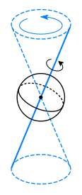
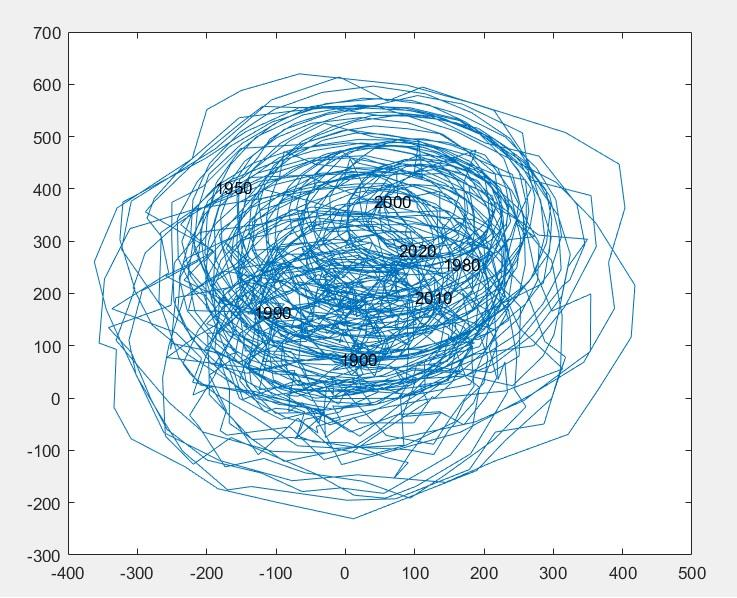

# 2 地球空间运动

## 公转与自转

地球一方面和太阳系里的其它行星一样，绕太阳公转，同时它也绕通过其质心的地轴由西向东自转。地球绕太阳公转的轨道面称为**黄道面**。通过地心且与地球自转轴垂直的平面称为**赤道面**。赤道面与黄道面的交角称之为**黄赤交角**，其值约为 $23.5^\circ$。

黄赤交角的存在导致太阳直射点的季节性变化，是四季和昼夜长短变化的根源。

## 天球

为了更方便地介绍地球空间运动，我们引入天球的概念。

**天球**是为描述天体视位置而引入的假想球面。半径可取任意长度。其中心可取观测者位置（观测者天球）或地球中心（地心天球）。

- 天顶 $Z$（zenith）：沿观测者头顶所指的方向作铅垂线向上延伸，与天球相交的一点。
- 天底 $Z'$：铅垂线在观测者脚底向地平以下无限延伸与天球相交的另一点 。
- 地平面，地平圈：过天球中心并与 $ZZ'$ 相垂直的平面。

- 天极（celestial pole）：地球自转轴所在直线与天球表面的交点。
- 天赤道（celestial equator）：地球赤道面与天球球面相交而成的大圆。
- 等分点 / 平分点：赤道与黄道的交点
  - 春分点：对应北半球春天的等分点
  - 秋分点：对应北半球秋天的等分点
- 赤经圈：与天赤道垂直的任意大圆，经线在天球上的投影。过南北天极。
- 赤纬圈：与天赤道平行的任意小圆，纬线在天球上的投影。

- 垂直圈：通过天顶天底的任意大圆，也称地平经圈。
- 子午圈（meridian）：过天顶天底、南北天极的大圆，是特殊的垂直圈，也是特殊的赤经圈。
- 卯酉圈（prime vertical）：过天顶天底且与子午圈垂直的大圆，是特殊的垂直圈。

## 岁差、章动和极移

### 岁差与章动

由于地球绕太阳公转，而同时又绕通过自身质心的轴自转，其在物理上属于做陀螺运动的物体。根据陀螺体动力学方程求解，可以推知它的自转轴会以地心为顶点绕着黄天极做顺时针运动，近似扫过一个圆锥面。

地球自转轴绕黄天极运动的现象称之为**进动**。地球自转轴绕黄天极进动一圈大约需要 2.6 万年，天文上称之为大年。

**岁差**：进动造成的春分点沿黄道西移，大约为每年 $50.3''$。

**章动**：地球在受太阳引力作用下作公转的同时，还受到月球和其他星体的引力作用，这会造成地球进动轴周期性偏离进动的圆锥面，周期大约为 18.6 年。

也就是说，可以把地轴绕着黄天极的运动分解成岁差和章动两个部分。

### 极移

另一方面，人们发现地球的自转轴与固体地球表面的交点（称**地极**）也不是固定的，而是随时间变化的，这种现象称之为**极移**。

通常规定某个时刻或者某段时间内地极的平均位置
作为**协议地极原点**，习惯上，使用**国际协议原点 CIO**，它是 1900 ~ 1905 年地极的平均位置。对应的地轴称之为**协议地轴**。采用地极在参考椭球表面上的位置相对于协议地极原点的偏差表示极移大小。

> 使用国际协议原点，以参考椭球的切平面内的格林尼治方向和西经 $90^\circ$ 方向分别为 $X$ 轴和 $Y$ 轴正方向，极移可以用 $(X,Y)$ 坐标来表示。习惯上极移坐标单位为秒，通常在 $0.1''\sim0.4''$ 范围内变化（对应在地表大约 ${12\operatorname m}\times12\operatorname m$，有半个篮球场大小）。下图显示了自 1900 年到 2022 年间的极移变化情况。
>
> 

## 惯性坐标系与地固坐标系

### 惯性坐标系

**惯性坐标系**：惯性坐标系又称天固坐标系， 原点放在地心 （或日心），$Z$ 轴与地球自转轴重合，$X$ 轴指向对应的春分点，$Y$ 轴与 $X,Z$ 轴构成右手系。

由于地球自转，在惯性坐标系中，地球上点的坐标是随时间变化的。显然，这不便于实际测量应用。

### 地心地固坐标系

**地心地固坐标系**：原点放在地心，$Z$ 轴与地球自转轴重合，$X$ 轴指向首子午线与赤道的交点，$Y$ 轴与 $X,Z$ 轴构成右手系。

由于坐标系随地球一起自转，假定地球表面某点没有移动，点的坐标就不会变化。

### 协议坐标系

由于地球的自转轴在空间的指向是随时间变化的（岁差和章动），相对于地球物理表面的指向也是变化的（极移），因此述坐标系的定义会不断变化。

因此，定义由地心指向协议原点的轴作为**协议地球自转轴**。使用国际协议原点 CIO 即可定义 1900 协议地心地固坐标系和惯性坐标系，简称**协议地心坐标系**和**协议惯性坐标系**。将协议地球自转轴与天球的交点称为**协议天极**。

于协议惯性系相对应地，基于瞬时天极与瞬时春分点的，称为**瞬时惯性系**。
