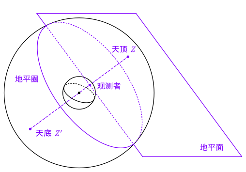
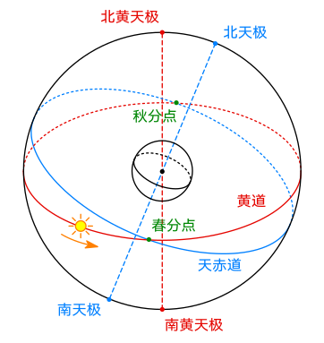
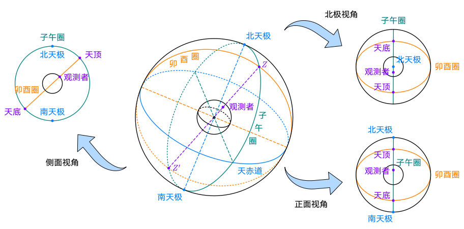

# 2 地球运动与坐标系

## 地球空间运动

地球一方面和太阳系里的其它行星一样，绕太阳公转，同时它也绕通过其质心的地轴由西向东自转。地球绕太阳公转的轨道 面称为**黄道面**。通过地心且与地球自转轴垂直的平面称为**赤道面**。赤道面与黄道面的交角称之为**黄赤交角**，其值约为 $23.5^\circ$。

黄赤交角的存在导致太阳直射点的季节性变化，是四季和昼夜长短变化的根源。

## 天球

**天球**是为描述天体视位置而引入的假想球面。半径可取任意长度。其中心可取观测者位置（观测者天球）或地球中心（地心天球）。

- 天顶 $Z$（zenith）：沿观测者头顶所指的方向作铅垂线向上延伸，与天球相交的一点。
- 天底 $Z'$：铅垂线在观测者脚底向地平以下无限延伸与天球相交的另一点 。
- 地平面，地平圈：过天球中心并与 $ZZ'$ 相垂直的平面。

- 天极（celestial pole）：地球自转轴所在直线与天球表面的交点。
- 天赤道（celestial equator）：地球赤道面与天球球面相交而成的大圆。
- 等分点 / 平分点：赤道与黄道的交点
  - 春分点：对应北半球春天的等分点
  - 秋分点：对应北半球秋天的等分点
- 赤经圈：与天赤道垂直的大圆，经线在天球上的投影。
- 赤纬圈：与天赤道平行的小圆，纬线在天球上的投影。

- 子午圈（meridian）：过北天极的地平经圈（通过天顶和北天极的大圆）。
- 卯酉圈：与子午圈垂直的地平经圈。
- 视角 $t$：观测点所在的子午圈与瞬时目标天体所在赤经圈的夹角。

### 天体视运动

地球自转使天体呈现从东向西的周日视运动；地球公转使太阳相对恒星背景呈现周年视运动。天体经过测站子午圈的瞬间称为==中天==，分为上中天和下中天。

## 岁差、章动和极移

参考轴并非永远固定。日月等天体对地球的引力会改变地轴指向和轨道平面方向，从而使天极、天赤道、春分点和黄道的位置随时间缓慢变化。

- ==岁差==：以长期、缓慢的系统性变化为主；春分点沿黄道向西移动。课件给出的主周期约为 $25\,800\ \mathrm{a}$，春分点年西退约 $50.37''$。
- ==章动==：叠加在岁差上的周期性短周期摆动，主周期约 $18.6\ \mathrm{a}$，量级以角秒计。
- ==极移==：地球自转轴相对于地球本体的位置变化，即地极在地表附近移动。它会影响地固坐标系与天球坐标系之间的转换。

这些效应解释了为什么高精度空间测量不能只写一个“地心坐标系”：坐标轴的定义和观测历元同样重要。

## 时间系统

时间由==起始历元==和==秒长==共同确定。不同时间系统依据不同的周期性过程建立。

| 类别   | 基础               | 代表时间                                  |
| ------ | ------------------ | ----------------------------------------- |
| 世界时 | 地球自转           | 恒星时、真太阳时、平太阳时、UT0、UT1、UT2 |
| 原子时 | 原子能级跃迁       | TA、TAI、UTC                              |
| 力学时 | 天体运动与历表计算 | TDB、TT                                   |

### 世界时

世界时以地球自转为基础。恒星时在数值上等于春分点的时角；真太阳时以真太阳的周日运动为依据，但受地球轨道偏心和黄赤交角影响，真太阳日长短不一。平太阳时将假想平太阳设为在天赤道上匀速运动，以获得较均匀的时间尺度。

UT0 为未经极移修正的观测时间；UT1 在 UT0 基础上改正极移影响，是常用的地球自转时间。高精度应用还需关注地球自转速度不均匀造成的差异。

### 原子时与协调世界时

原子秒以铯-133 原子特定超精细能级跃迁的 $9\,192\,631\,770$ 个周期定义。国际原子时 TAI 由全球原子钟比对和处理得到，具有很高均匀性。

UTC 的秒长与原子秒一致，但通过闰秒让其时刻尽量接近 UT1。因此 UTC 适合民用时间服务，却不能在所有精密动力学计算中直接替代连续的原子时或力学时。

### 力学时

天体动力学和星历计算使用力学时。地球时 TT 与 TAI 的关系为

$$
\mathrm{TT}=\mathrm{TAI}+32.184\ \mathrm{s}.
$$

课件同时给出太阳系质心力学时 TDB 和以地球为中心的力学时间概念。核心要点是：时间系统的选择取决于所描述的物理过程，不能只因名称相近而混用。

## 坐标系的定义与转换

一个直角坐标系应明确三个要素：==原点、基本平面和主轴==。通常采用右手坐标系。描述一个向量时，必须同时说明该向量在哪个坐标系中展开；同一几何向量在不同基底下的三个坐标分量可以不同。

### 方向余弦矩阵

设向量的坐标分量由 $Q$ 系转换至 $P$ 系，记为

$$
\boldsymbol r^P=\boldsymbol C^P_Q\boldsymbol r^Q.
$$

其中 $\boldsymbol C^P_Q$ 为方向余弦矩阵，其元素是两组单位基向量的内积；矩阵的每一列可理解为 $Q$ 系相应坐标轴在 $P$ 系三轴上的投影。对于正交坐标系，方向余弦阵为正交阵：

$$
(\boldsymbol C^P_Q)^{-1}=(\boldsymbol C^P_Q)^{\mathrm T}.
$$

矩阵下标和上标的方向必须写清楚。很多坐标变换错误并非计算失误，而是把“坐标轴旋转”和“坐标分量转换”的方向混淆。

### 常用天球与地球坐标系

| 坐标系             | 原点与轴的要点                                                   | 用途                       |
| ------------------ | ---------------------------------------------------------------- | -------------------------- |
| 协议天球坐标系 CIS | 原点在地球质心，J2000.0 历元的平天极和春分点定义轴               | 近似惯性参考               |
| 瞬时真天球坐标系   | $Z$ 轴指向瞬时真天极，$X$ 轴指向瞬时真春分点                     | 包含岁差、章动后的瞬时方向 |
| 协议地球坐标系 CTS | 原点在地球质心，$Z$ 轴指向协议地极，$X$ 轴指向格林尼治起始子午面 | 地面站和地球表面位置       |
| 瞬时地球坐标系     | $Z$ 轴随瞬时地球自转轴变化                                       | 高精度地球姿态描述         |

从协议天球系到协议地球系，需要依次处理岁差、章动、地球自转和极移等效应。它们分别对应“天球轴缓慢变化”“短周期摆动”“地球绕轴转动”和“地轴相对地壳移动”，不可用一个固定旋转矩阵替代。
