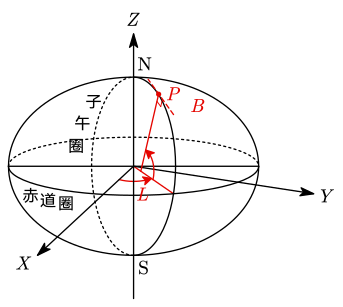
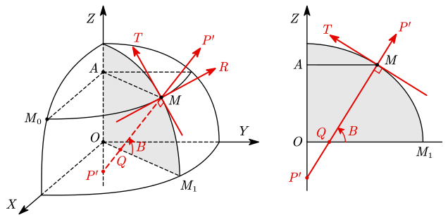
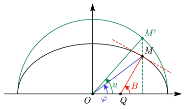
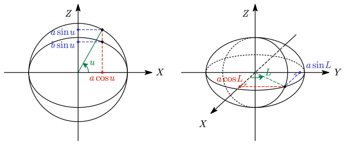

# 3 地球椭球与坐标系

## 地球椭球的几何元素

无论是参考椭球抑或是平均地球椭球，从几何上来说都是旋转椭球，亦即由长半轴为 $a$、短半轴为 $b$ 的椭圆绕其短轴而成的几何形体。

以椭球的中心 $O$ 为原点，旋转轴为 $Z$ 轴，赤道面为 $XOY$ 平面，构建空间直角坐标系，则旋转椭球面可以描述为

$$
\frac{X^2}{a^2}+\frac{Y^2}{a^2}+\frac{Z^2}{b^2}=1
$$

由椭球的长短半轴 $a,b$ 即可确定椭球的形状和大小。通常仅采用一个长度元素 $a$ 以确定椭球的大小，而用扁率 $\alpha$（有时也用 $f$）或第一偏心率 $e$ 来反映椭球的形状（扁平程度）。

定义**扁率 $\alpha$ 与第一偏心率 $e$**：

$$
\begin{gathered}
\alpha=\frac{a-b}a \\[1em]

e=\frac{\sqrt{a^2-b^2}}a,\quad
1-e^2=\frac{b^2}{a^2}
\end{gathered}
$$

二者的关系为：

$$
e^2=2\alpha-\alpha^2
$$

通常采用数值接近于零的 $\alpha$ 或 $e$ 取代 $b$，以便于作级数展开等运算。扁率 $\alpha$ 的倒数 $1/\alpha$ 常称作**反扁率**。

近似看作圆球面时，$\alpha=e=0$。

有时也使用第二偏心率 $e'=\dfrac{\sqrt{a^2-b^2}}b$，满足 $1+e'^2=\dfrac{a^2}{b^2}$。

## 参考椭球上的点和线

### 经线和纬线的曲线方程

> [我们在高等数学中学过](/高等数学/8-空间解析几何/8.3-曲面与曲线)，空间曲线通常使用两个面的交线表达。

以起始子午面为 $XOZ$ 坐标面建系，则起始子午线（$0^\circ$ 经线）是 $XOZ$ 面与椭球的交线。其方程为：

$$
\dfrac{X^2}{a^2}+\dfrac{Z^2}{b^2}=1,\quad Y=0
$$

设 $M_0(X_0,Y_0,Z_0)$ 为该起始经线上一点，其三维坐标满足上式。

设 $M_0$ 旋转一定角度后生成一个点 $M(X,Y,Z)$，则称这个角度为 $M$ 处的**大地经度**，通常用字母 $L$ 表示。大地经度定义为所在子午面与起始子午面间二面角的平面角，规定向东（$Z$ 轴的右手螺旋方向）为正、向西为负。

经线圈方程可以表达为所在子午面截椭圆：

$$
\dfrac{X^2}{a^2}+\dfrac{Z^2}{b^2}=1,\quad \frac YX=\tan L
$$

点 $M_0$ 在旋转过程中，产生了旋转椭球面上的一个纬圈（平行圈）。纬圈是一个圆，所在平面与 $XOY$ 坐标面（赤道面）平行。设该平面与 $Z$ 轴交于 $A$，纬圈半径 $r$ 满足：

$$
r=AM=AM_0=X_0=\sqrt{X^2+Y^2}
$$

纬线圈方程可以表达为所在平面截椭圆：

$$
\dfrac{X^2}{a^2}+\dfrac{Z^2}{b^2}=1,\quad Z=Z_0
$$

### 椭球面法线与大地纬度

过点 $M$，作平行圈的切线 $MR$，作子午圈的切线 $MT$，则 $MR$ 与 $MT$ 构成在 $M$ **椭球面的切平面**。过点 $M$ 作切平面的垂线 $MP$，称为 $M$ 处的**椭球面法线**。

椭球面法线交旋转轴于 $P$，交赤道面于 $Q$。定义椭球面法线与赤道面的夹角为 $M$ 点处的**大地纬度**，通常用 $B$ 表示。规定北半球为正，南半球为负。

在微分几何的曲线理论中，利用曲线上任一点处的三个互相正交的单位向量来构成一个三维直角坐标系，称之为 Frenet 活动标架。在椭球面上，这里的 $MP,MR,MT$ 三个方向可以定义此处的 Frenet 标架。若将原点由 $M$ 移至测站中心，即可构建站心地平坐标系。我们将在后续章节详细讨论。

### 归化纬度与地心纬度

值得一提的是，椭球面法线不是点与椭球中心的连线，只有南北两极的椭球面法线会过椭球中心。

在大地测量中除了用大地纬度 $B$ 外，还采用归化纬度 $u$ 和地心纬度 $\varphi$ 来表示椭圆上点的位置。

作中心与椭球中心 $O$ 重合、半径等于椭球长半轴的球。过点 $M$ 作赤道面的垂线，交该球于点 $M'$。连接 $M'$ 与椭球中心 $O$。定义 $OM'$ 与赤道面的夹角为 $M$ 点的**归化纬度**，通常用字母 $\varphi$ 表示。

连接点 $M$ 与椭球中心 $O$。定义 $OM$ 与赤道面的夹角为 $M$ 点的**地心纬度**，通常用字母 $\varphi$ 表示。

下面是一幅交互式示意图。$M$ 点可以拖动，也可以点击左下角播放暂停按钮控制自动移动。

<<< ./images/latitude.ggb

不难证明，地心纬度 $\varphi$、归化纬度 $u$ 和大地纬度 $B$ 存在如下关系：

$$
\tan\varphi=\frac ba\tan u=\frac{b^2}{a^2}\tan B
$$

::: details 证明过程

为熟悉起见，取过点 $M$ 的子午面重新建立平面直角坐标系 $xOy$。设截出的椭圆方程为 $\dfrac{x^2}{a^2}+\dfrac{y^2}{b^2}=1$，截出的圆方程为 $x^2+y^2=a^2$，点 $M$ 坐标为 $(x_M,y_M)$。

最简单的是地心纬度：$\tan\varphi=k_{OM}=\dfrac{y_M}{x_M}$。

接下来考虑归化纬度。过点 $M$ 垂直于赤道面的直线为 $x=x_M$，即 $x_{M'}=x_M$。代入圆方程求 $y_{M'}$：

$$
\begin{cases}
x_{M'}^2+y_{M'}^2=a^2 \\
x_{M'}=x_M
\end{cases}
\Rightarrow y_{M'}^2=a^2-x_M^2
$$

由于 $M$ 坐标符合椭圆方程，因此有

$$
\begin{aligned}
\frac{x_M^2}{a^2}+\frac{y_M^2}{b^2}&=1 \\
x_M^2+\frac{a^2y_M^2}{b^2}&=a^2 \\
a^2-x_M^2&=\frac{a^2y_M^2}{b^2}
\end{aligned}
$$

代入 $y_{M'}$ 表达式得到

$$
\begin{gathered}
y_{M'}^2=a^2-x_M^2=\frac{a^2y_M^2}{b^2} \\
\Rightarrow y_{M'}=\frac{ay_M}{b}
\end{gathered}
$$

故有

$$
\tan u=k_{OM'}
=\frac{y_{M'}}{x_{M'}}
=\frac{ay_M}{b}\cdot\frac1{x_M}
=\frac ab\cdot\frac{y_M}{x_M}
$$

考虑大地纬度。设椭圆过点 $M$ 的切线为 $l$。要先求 $l$ 的斜率 $k_l$。

在初等数学中，我们可以用 $k_l$ 表达出 $l$ 的方程 $y-y_M=k(x-x_M)$，与椭圆方程联立并代入消 $y$ 后得到一个关于 $x$ 的二次方程，令判别式 $\varDelta=0$ 解方程得到 $k_l$。不过我们现在已经是大学生了，不妨使用高等数学中介绍过的 [隐函数求导](/高等数学/9-多元函数微分学/9.3-隐函数的微分) 直接求解。

已知 $x,y$ 的关系由 $F(x,y)=\dfrac{x^2}{a^2}+\dfrac{y^2}{b^2}-1=0$ 确定。由偏导数

$$
\begin{gathered}
F_x=\frac{\partial F}{\partial x}=\frac{2x}{a^2} \\
F_y=\frac{\partial F}{\partial y}=\frac{2y}{b^2} \\
\end{gathered}
$$

则有

$$
\frac{\mathrm dy}{\mathrm dx}
=-\frac{F_x}{F_y}
=-\frac{2x}{a^2}\cdot\frac{b^2}{2y}
=-\frac{b^2}{a^2}\cdot\frac xy
$$

故

$$
k_l=\left.\frac{\mathrm dy}{\mathrm dx} \right|_{\substack{x=x_M\\y=y_M}}
=-\frac{b^2}{a^2}\cdot\frac{x_M}{y_M}
$$

则有

$$
\tan B=k_{QM}=-\frac1{k_l}=\frac{a^2}{b^2}\cdot\frac{y_M}{x_M}
$$

总结一下，有：

$$
\begin{aligned}
\tan\varphi&=\dfrac{y_M}{x_M} \\
\tan u&=\frac ab\cdot\frac{y_M}{x_M} \\
\tan B&=\frac{a^2}{b^2}\cdot\frac{y_M}{x_M}
\end{aligned}
$$

因此有

$$
\tan\varphi=\frac ba\tan u=\frac{b^2}{a^2}\tan B
$$

证毕。

:::

## 椭球面的参数方程

正则曲面上的点有两个自由度，因此曲面上点位的坐标 $(X,Y,Z)$ 可表示成两个参数的单值函数，即曲面的参数方程。而曲线上的点只有一个自由度，可表示为单参数的函数。

### 以归化纬度与大地经度为参数

我们前面提到了归化纬度 $u$。为何要定义一个以长半轴为半径的球，导出这样一个量？我们知道，在平面上，圆与椭圆具有仿射变换关系。椭圆可以看作是圆在短轴上缩放 $b/a$ 倍的结果。可以利用这一点书写参数方程。

取首子午面（$XOZ$ 坐标面）研究。以 $a$ 为半径的圆，以 $u$ 为参数，参数方程可以写作：

$$
\begin{cases}
X=a\cos u \\
Z=a\sin u
\end{cases}
$$

在短轴（$Z$ 轴）上缩放 $b/a$ 倍，即把 $Z$ 坐标乘以 $b/a$，即可得到首子午圈的曲线参数方程：

$$
\begin{cases}
X=a\cos u \\
Z=b\sin u
\end{cases}
$$

首子午圈绕 $Z$ 轴旋转形成椭球面。取旋转角（也就是大地经度）$L$ 为第二个参数，即可写出参考椭球的参数方程：

$$
\begin{cases}
X=a\cos u\cos L \\
Y=a\cos u\sin L \\
Z=b\sin u
\end{cases}
$$

三角函数将旋转语义表达得很直观。

### 以大地纬度与大地经度为参数

我们前面已经提到大地纬度与归化纬度之间的转化关系：

$$
\begin{gathered}
\tan\varphi=\frac ba\tan u=\frac{b^2}{a^2}\tan B \\
\Rightarrow \tan u=\frac ba\tan B
\end{gathered}
$$

因此，只需要按此式推出 $\varphi$ 与 $B$ 正弦、余弦值的关系，代入即可得到以大地纬度与大地经度为参数的椭球面参数方程了。

::: details 推导过程

$$
\begin{aligned}
\cos^2 u
&=\frac1{1+\tan^2u} \\
&=\frac1{1+\frac{b^2}{a^2}\tan^2B} \\
&=\frac{\cos^2B}{\cos^2B+\frac{b^2}{a^2}\sin^2B}
\end{aligned}
$$

其中的分母：

$$
\begin{aligned}
\text{Denominator}
&=\cos^2B+\frac{b^2}{a^2}\sin^2B \\
&=1-\sin^2B+\frac{b^2}{a^2}\sin^2B \\
&=1-\frac{a^2-b^2}{a^2}\sin^2B \\
&=1-e^2\sin^2B
\end{aligned}
$$

带回 $\cos^2 u$ 得

$$
\begin{aligned}
\cos^2 u&=\frac{\cos^2B}{1-e^2\sin^2B} \\
\Rightarrow \cos u&=\frac{\cos B}{\sqrt{1-e^2\sin^2B}}
\end{aligned}
$$

由几何关系可得，$u$ 与 $B$ 必为同象限角，余弦值正负性相同。故舍去负根。

又有

$$
\begin{aligned}
\sin^2u
&=1-\cos^2u \\
&=1-\frac{\cos^2B}{1-e^2\sin^2B} \\
&=\frac{1-e^2\sin^2B-\cos^2B}{1-e^2\sin^2B}
\end{aligned}
$$

其中的分子：

$$
\begin{aligned}
\text{Numerator}
&=1-e^2\sin^2B-\cos^2B \\
&=\sin^2B-e^2\sin^2B \\
&=(1-e^2)\sin^2B \\
&=\frac{b^2}{a^2}\sin^2B
\end{aligned}
$$

带回 $\sin^2 u$ 得

$$
\begin{aligned}
\sin^2 u&=\frac{b^2}{a^2}\frac{\sin^2B}{1-e^2\sin^2B} \\
\Rightarrow \sin u&=\frac{b\sin B}{a\sqrt{1-e^2\sin^2B}}
\end{aligned}
$$

由几何关系可得，$u$ 与 $B$ 必为同象限角，正弦值正负性相同。故舍去负根。

综上，有

$$
\begin{cases}
\cos u=\dfrac{\cos B}{\sqrt{1-e^2\sin^2B}} \\[1.2em]
\sin u=\dfrac{b\sin B}{a\sqrt{1-e^2\sin^2B}}
\end{cases}
$$

又已知参考椭球关于 $u,L$ 的参数方程

$$
\begin{cases}
X=a\cos u\cos L \\
Y=a\cos u\sin L \\
Z=b\sin u
\end{cases}
$$

代入即可得到关于 $B,L$ 的参数方程。

:::

原始方程：

$$
\begin{cases}
X=\dfrac{a\cos B\cos L}{\sqrt{1-e^2\sin^2B}} \\[1.2em]
Y=\dfrac{a\cos B\sin L}{\sqrt{1-e^2\sin^2B}} \\[1.2em]
Z=\dfrac{b^2\sin B}{a\sqrt{1-e^2\sin^2B}}
\end{cases}
$$

采用辅助符号：

$$
W=\sqrt{1-e^2\sin^2B},\quad N=\frac aW
$$

代入则有：

$$
\begin{cases}
X=N\cos B\cos L \\
Y=N\cos B\sin L \\
Z=N(1-e^2)\sin B
\end{cases}
$$

### 以球心纬度与大地经度为参数

推导过程类似大地纬度，从略。

$$
\begin{cases}
X=a\cos\varphi\cos L\sqrt{\dfrac{1-e^2}{1-e^2\cos^2\varphi}} \\[1.5em]
Y=a\cos\varphi\sin L\sqrt{\dfrac{1-e^2}{1-e^2\cos^2\varphi}} \\[1.5em]
Z=a\sin\varphi\sqrt{\dfrac{1-e^2}{1-e^2\cos^2\varphi}}
\end{cases}
$$

## 地心坐标系与参心坐标系

==地心坐标系==以地球质心为原点建立，现代全球卫星定位主要采用这一类坐标系统，例如 WGS 84 和 CGCS2000。==参心坐标系==以参考椭球中心为原点，历史上曾被广泛使用，但已不适合全球统一参考。

WGS 84 与 CGCS2000 都属于地心坐标框架，在一般工程和导航应用中其参数差异通常可忽略；但在高精度控制、基准转换或成果发布时，仍应按正式规范说明所用框架、历元和转换参数。

> 不应把天文惯性参考的 J2000.0 与中国大地坐标系 CGCS2000 当成同一坐标系。两者名称中都含“2000”，但服务对象、定义方式和使用场景不同。

## 大地坐标

椭球面上的点常以==大地经度、大地纬度和椭球高==表示。

- ==大地经度 $L$ 或 $\lambda$==：包含该点椭球法线的子午面与本初子午面的夹角；
- ==大地纬度 $B$ 或 $\varphi$==：该点椭球法线与赤道面的夹角；
- ==椭球高 $h$==：点沿椭球法线到参考椭球面的距离。

大地纬度由==法线==定义，不能与地心纬度混为一谈。地心纬度由地心到该点的连线与赤道面的夹角定义；除赤道和两极外，两者一般不相等。

## 卯酉圈曲率半径与子午圈曲率半径

椭球面不是常曲率曲面。同一点沿东西方向和南北方向的曲率不同，因而引入两类主曲率半径。

设

$$
W=\sqrt{1-e^2\sin^2B},
$$

则

$$
N=\frac{a}{W}
$$

为==卯酉圈曲率半径==，对应东西向平行圈；

$$
M=\frac{a(1-e^2)}{W^3}
$$

为==子午圈曲率半径==，对应南北向子午圈。

这两个量是椭球几何计算的基础。将小范围经纬度增量转换为地表弧长时，可近似写为

$$
\mathrm ds_N\approx M\,\mathrm dB,
\qquad
\mathrm ds_E\approx N\cos B\,\mathrm dL.
$$

因此，不能把经纬度差直接当作等距的平面坐标增量；纬度和方向都会影响对应弧长。

## 大地坐标与地心直角坐标的转换

设点的大地坐标为 $(L,B,h)$，则其地心地固直角坐标为

$$
\begin{aligned}
X&=(N+h)\cos B\cos L,\\
Y&=(N+h)\cos B\sin L,\\
Z&=\bigl[N(1-e^2)+h\bigr]\sin B.
\end{aligned}
$$

其几何含义很直接：先按纬度把点投影到赤道面，再按经度分解到 $X$、$Y$ 轴；$Z$ 分量由纬度及椭球扁率共同决定。

反算 $(X,Y,Z)\to(L,B,h)$ 通常采用迭代或专门闭式算法。原因在于 $N$ 自身依赖未知纬度 $B$，不能简单用球坐标公式替代。

## 当地水平坐标系

地心地固坐标适合描述全球位置，但对局部导航不直观。以测站为原点，可建立东北天坐标系（ENU）或北东地坐标系（NED）。它们的轴分别与当地子午线、平行圈和椭球法线相关。

当地水平坐标系的价值在于：

- 位置、速度和姿态增量具有直接的“向北、向东、向上”物理意义；
- 能把全球地心坐标转为局部工程或导航计算中易解释的量；
- 其旋转矩阵由测站的大地经纬度确定。

坐标变换时务必注明采用 ENU 还是 NED，以及旋转矩阵表示的是“坐标轴变换”还是“同一向量坐标分量的转换”。

## 高程关系

GNSS 给出的椭球高 $h$ 与水准测量常用的正常高或正高并不相同。用 $H$ 表示与重力场有关的高程、$N_g$ 表示大地水准面高时，常用的关系形式为

$$
h\approx H+N_g.
$$

这里的近似形式强调三者的几何关系；在精密高程处理中，应采用相应高程系统和重力场模型的严格定义。后续学习大地水准面和引力位后，才能完整解释该关系的物理含义。

## 预习：引力位

下一阶段将引入==引力位==。可以先把它理解为描述引力场“势”的标量函数：等位面上任意两点的引力位相等，重力方向与等位面正交。大地水准面正是一个与平均海平面接近的特定等位面。
