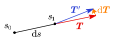

# 4 地球椭球的性质

## 椭球的几何性质

旋转椭球面具有下述性质：

- 对称性：椭球关于中心点对称、关于赤道面对称、关于任意子午面对称；
- 有界性：$|X|\le a,\,|Y|\le a,\,|Z|\le b$。也就是说，椭球面被限定在六个平面 $X=\pm a,\,Y=\pm a,\,Z=\pm b$ 所围成的长方体内；
- 正则性：椭球面是一个连续、封闭的正则曲面，每个曲面点上都有唯一确定的非零法向量；
- 不可展性：旋转椭球面不可展开为平面，若强行拉平则会出现重叠和裂口。（柱面与锥面是可展曲面）

## 椭球的切向量与法向量

### 子午圈切向量

我们可以把椭球上的点用位置矢量 $\boldsymbol r$ 表示：

$$
\boldsymbol r
=\begin{bmatrix}
X\\ Y\\ Z
\end{bmatrix}
=\begin{bmatrix}
N\cos B\cos L\\
N\cos B\sin L\\
N(1-e^2)\sin B
\end{bmatrix}
$$

其中 $W=\sqrt{1-e^2\sin^2B}$，$N=\dfrac aW=\dfrac a{\sqrt{1-e^2\sin^2B}}$

这样，$\dfrac{\partial \boldsymbol r}{\partial B}$ 与 $\dfrac{\partial \boldsymbol r}{\partial L}$ 就分别是椭球面上 $\boldsymbol r$ 处的经线和纬线方向的切向量，也就是子午圈与平行圈的切向量。

::: details $\dfrac{\partial \boldsymbol r}{\partial B}$ 推导过程

考虑 $X$：

$$
\frac{\partial X}{\partial B}=
\frac{\partial N}{\partial B}\cos B\cos L-N\sin B\cos L
$$

其中：

$$

\begin{aligned}
\frac{\partial N}{\partial B}
&=\frac\partial{\partial B}\frac a{\sqrt{1-e^2\sin^2B}} \\
&=-\frac a{2(1-e^2\sin^2B)^{3/2}}\cdot\frac\partial{\partial B}(1-e^2\sin^2B) \\
&=-\frac a{2(1-e^2\sin^2B)^{3/2}}\cdot2e^2\sin B\cos B \\
&=\frac{ae^2\sin B\cos B}{(1-e^2\sin^2B)^{3/2}} \\
&=\frac{ae^2\sin B\cos B}{W^3}
\end{aligned}
$$

带回 $\dfrac{\partial X}{\partial B}$ 得到：

$$
\begin{aligned}
\frac{\partial X}{\partial B}&=
\frac{ae^2\sin B\cos B}{W^3}\cos B\cos L-\frac aW\sin B\cos L \\
&=\frac{a\sin B\cos L}{W^3}(e^2\cos^2B-W^2) \\
&=\frac{a\sin B\cos L}{W^3}(e^2\cos^2B-1+e^2\sin^2B) \\
&=\frac{a\sin B\cos L}{W^3}(e^2-1) \\
&=-\frac{a(1-e^2)}{W^3}\sin B\cos L \\
\end{aligned}
$$

令 $\displaystyle M=\frac{a(1-e^2)}{W^3}=\frac{a(1-e^2)}{(1-e^2\sin^2B)^{3/2}}$，则有：

$$
\frac{\partial X}{\partial B}=-M\sin B\cos L
$$

同理有：

$$
\frac{\partial Y}{\partial B}=-M\sin B\sin L
$$

下面考虑 $Z$：

$$
\begin{aligned}
\frac{\partial Z}{\partial B}
&=\frac\partial{\partial B}N(1-e^2)\sin B \\
&=(1-e^2)\left(\frac{\partial N}{\partial B}\sin B+N\cos B\right) \\
&=(1-e^2)\left(\frac{ae^2\sin B\cos B}{W^3}\sin B+\frac aW\cos B\right) \\
&=\frac{a(1-e^2)\cos B}{W^3}(e^2\sin B+W^2) \\
&=\frac{a(1-e^2)\cos B}{W^3}(\cancel{e^2\sin B}+1-\cancel{e^2\sin B}) \\
&=\frac{a(1-e^2)}{W^3}\cos B \\
&=M\cos B \\
\end{aligned}
$$

综上，有

$$
\begin{aligned}
\frac{\partial X}{\partial B}&=-M\sin B\cos L \\[0.7em]
\frac{\partial Y}{\partial B}&=-M\sin B\sin L \\[0.7em]
\frac{\partial Z}{\partial B}&=M\cos B
\end{aligned}
$$

:::

可以得到：

$$
\frac{\partial\boldsymbol r}{\partial B}
=\begin{bmatrix}
\partial X/\partial B\\
\partial Y/\partial B\\
\partial Z/\partial B\\
\end{bmatrix}
=M\begin{bmatrix}
-\sin B\cos L\\
-\sin B\sin L\\
\cos B\\
\end{bmatrix}
$$

其中 $\displaystyle M=\frac{a(1-e^2)}{W^3}=\frac{a(1-e^2)}{(1-e^2\sin^2B)^{3/2}}$

> 这个 $M$ 是一个有意义的量：子午圈曲率半径。我们马上就会再见到它。

所以有 $B,L$ 处的子午圈单位切向量：

$$
\boldsymbol T_{\text{meridian}}=\begin{bmatrix}
-\sin B\cos L\\
-\sin B\sin L\\
\cos B\\
\end{bmatrix}
$$

其模长为 $1$。

### 平行圈切向量

::: details $\dfrac{\partial \boldsymbol r}{\partial L}$ 推导过程

$$
\begin{aligned}
\frac{\partial X}{\partial L}
&=\frac\partial{\partial L}N\cos B\cos L
=-N\cos B\sin L \\[1em]

\frac{\partial Y}{\partial L}
&=\frac\partial{\partial L}N\cos B\sin L
=N\cos B\cos L \\[1em]

\frac{\partial Z}{\partial L}
&=\frac\partial{\partial L}N(1-e^2)\sin B
=0
\end{aligned}
$$

:::

可以得到：

$$
\frac{\partial\boldsymbol r}{\partial N}
=\begin{bmatrix}
\partial X/\partial N\\
\partial Y/\partial N\\
\partial Z/\partial N\\
\end{bmatrix}
=N\cos B\begin{bmatrix}
-\sin L\\
\cos L\\
0\\
\end{bmatrix}
$$

所以有 $B,L$ 处的平行圈单位切向量：

$$
\boldsymbol T_{\text{parallel}}\begin{bmatrix}
-\sin L\\
\cos L\\
0\\
\end{bmatrix}
$$

其模长为 $1$。

### 椭球面法向量

将子午圈与平行圈的单位切向量作叉积，即可得到单位法向量：

$$
\boldsymbol n=
\begin{bmatrix}-\sin B\cos L\\-\sin B\sin L\\\cos B\\\end{bmatrix}
\times
\begin{bmatrix}-\sin L\\\cos L\\0\\\end{bmatrix}
=
\begin{bmatrix}
\cos B\cos L\\
\cos B\sin L\\
\sin B
\end{bmatrix}
$$

其模长为 $1$。

> 忘记叉积怎么算了？[高数笔记传送门](/高等数学/8-空间解析几何/8.1-向量及其运算#向量的向量积)

所以，法向量处处存在且不等于零。椭球面是正则的。

椭球面法向量的方向也就是铅垂线的方向。

## 椭球法截线的曲率及曲率半径

### 空间曲线的曲率及曲率半径

[高数课程中介绍过曲率以及曲率半径](/高等数学/3-导数的应用/3.8-曲率)。我们简单回顾一下。

曲线的曲率 $k$ 用于反映曲线的弯曲程度。一段弧 $\overset\frown {MM_0}$ 的平均曲率定义为 $M$ 点切向量与 $M'$ 点切向量的夹角，与这段弧长之比。$M,M'$ 两点无限接近时，定义这段曲线的曲率为 $M$ 处的曲率。定义曲率的倒数为曲率半径。曲率越大或曲率半径越小，则曲线的完全程度越高。

则曲线上一点 $C$ 的曲率记为该点切向量的一阶导数向量的模，或为该点位置向量 $\boldsymbol r(s)$ 二阶导数向量的模，即有

$$
k(s)|_{s=s_c}
=\left|\left.\frac{\mathrm d\boldsymbol T(s)}{\mathrm ds} \right|_{s=s_c}\right|
=\left|\left.\frac{\mathrm d^2\boldsymbol r(s)}{\mathrm ds^2} \right|_{s=s_c}\right|
$$

::: details 一种几何的理解方式

首先，若曲线以弧长 $s$ 为参数，则 $|\mathrm d\boldsymbol r|=\mathrm ds$，$|\boldsymbol T|=\left|\dfrac{\mathrm d\boldsymbol r}{\mathrm ds} \right|=1$。

假设有一段弧 $\mathrm ds$，前后位置向量关于 $s$ 的导数分别为 $\boldsymbol T,\boldsymbol T'$。$\boldsymbol T,\boldsymbol T'$ 在几何上是切向量，与 $\mathrm d\boldsymbol T$ 组成三角形。由于 $\mathrm d\boldsymbol T/\boldsymbol T\to0$，二者的夹角 $\mathrm d\alpha=\sin\mathrm d\alpha=\tan\mathrm d\alpha=|\mathrm d\boldsymbol T|/|\boldsymbol T|=|\mathrm d\boldsymbol T|$。

所以 $k=\dfrac{\mathrm d\alpha}{\mathrm ds}=\left| \dfrac{\mathrm d\boldsymbol T}{\mathrm ds}\right|$。

:::

若曲线不以弧长 $s$ 为参数，则由 $\dfrac{\mathrm d\boldsymbol r(s)}{\mathrm ds}=\dfrac{\mathrm d\boldsymbol r(s)}{\mathrm dt}\dfrac{\mathrm dt}{\mathrm ds}$ 再推及二阶导数式，即可得到在任意参数 $t$ 下，曲率的计算公式为

$$
k(t)
=\frac{\left|\dfrac{\mathrm d\boldsymbol r}{\mathrm dt}\times\dfrac{\mathrm d^2\boldsymbol r}{\mathrm dt^2} \right|}
{\left|\dfrac{\mathrm d\boldsymbol r}{\mathrm dt} \right|^3}
$$

::: details 一种物理的理解方式

我们知道曲率半径的引入让我们可以将更一般的曲线运动当作圆周运动处理。回忆一下高中物理中介绍的圆周运动向心加速度公式：

$$
a=\frac{v^2}{r}
$$

把半径 $r$ 改成曲率半径 $\rho$，整理一下：

$$
\begin{gathered}
|\boldsymbol a_{向心}|=\frac{|\boldsymbol v|^2}{\rho} \\
k=\frac1\rho=\frac{|\boldsymbol a_{向心}|}{|\boldsymbol v|^2}
\end{gathered}
$$

这里的 $\boldsymbol a_{向心}$ 是向心加速度，也就是正交于速度 $\boldsymbol v$ 方向上的加速度，也就是有：

$$
|\boldsymbol a_{向心}|
=|\boldsymbol a_总|\sin\left<\boldsymbol v,\boldsymbol a_总\right>
=\frac{|\boldsymbol v\times\boldsymbol a_总|}{|\boldsymbol v|}
$$

带回原式就有

$$
k=\frac{|\boldsymbol v\times\boldsymbol a_总|}{|\boldsymbol v|^3}
$$

取参数为时间 $t$，那么就有 $\boldsymbol v=\dfrac{\mathrm d\boldsymbol r}{\mathrm dt}$，$\boldsymbol a_总=\dfrac{\mathrm d^2\boldsymbol r}{\mathrm dt^2}$，这就得到了：

$$
k
=\frac{\left|\dfrac{\mathrm d\boldsymbol r}{\mathrm dt}\times\dfrac{\mathrm d^2\boldsymbol r}{\mathrm dt^2} \right|}
{\left|\dfrac{\mathrm d\boldsymbol r}{\mathrm dt} \right|^3}
$$

:::

### 法截线的定义

过椭球面上一点的椭球面法线所作的平面称为**法截面**，法截面同椭球的交线则称为**法截线**（也称法截弧）。上一节的天球部分中提到的垂直圈（地平经圈）的概念与此类似。

包含椭球面上一点的法线可以构成无数个法截面，相应的也有无数条法截线，它们都是平面曲线，而且曲率各不相同。

由于旋转曲面的特性，曲率的大小与经度无关。

### 子午圈曲率半径

子午线是特殊的法截线。

不失一般性，取 $XOZ$ 坐标面上的起始子午线，推求其上任一点 $M$ 的子午线曲率半径。为简化计算，使用归化纬度 $u$ 作为参数，则有 $M$ 的位置向量 $\boldsymbol r(u)$

$$
\boldsymbol r(u)=\begin{bmatrix}
X(u)\\ Y(u)\\ Z(u)
\end{bmatrix}
=\begin{bmatrix}
a\cos u\\ 0\\ b\sin u
\end{bmatrix}
$$

求一阶和二阶导数

$$
\begin{aligned}
\frac{\mathrm d\boldsymbol r(u)}{\mathrm du}&=
\begin{bmatrix}
-a\sin u\\ 0\\ b\cos u
\end{bmatrix} \\
\frac{\mathrm d^2\boldsymbol r(u)}{\mathrm du^2}&=
\begin{bmatrix}
-a\cos u\\ 0\\ -b\sin u
\end{bmatrix} \\
\end{aligned}
$$

于是得到

$$
\begin{gathered}
\frac{\mathrm d\boldsymbol r(u)}{\mathrm du}
\times
\frac{\mathrm d^2\boldsymbol r(u)}{\mathrm du^2}
=\begin{bmatrix}0 & -ab & 0\end{bmatrix}^{\mathrm T} \\[1em]
\left|
\frac{\mathrm d\boldsymbol r(u)}{\mathrm du}
\times
\frac{\mathrm d^2\boldsymbol r(u)}{\mathrm du^2}
\right|=ab \\[1em]
\left|
\frac{\mathrm d\boldsymbol r(u)}{\mathrm du}
\right|
=\sqrt{b^2\cos^2 u+a^2\sin^2 u}
\end{gathered}
$$

代入前面的曲率半径即可得到

$$
k(u)=\frac{ab}{(b^2\cos^2u+a^2\sin^2u)^{3/2}}
$$

利用我们前面提到过的 $u$ 与 $B$ 的关系，可以推出以大地纬度 $B$ 表达的曲率半径 $k(B)$：

$$
k(B)=\frac{W^3}{a(1-e^2)}
$$

::: details 推导过程

我们之前在推导 [以大地纬度与大地经度为参数的椭球参数方程](./3-地球椭球面的表达#以大地纬度与大地经度为参数) 时得到过如下式子：

$$
\begin{aligned}
\cos^2 u&=\frac{\cos^2B}{1-e^2\sin^2B}=\frac{\cos^2B}{W^2} \\[1em]
\sin^2 u&=\frac{b^2}{a^2}\frac{\sin^2B}{1-e^2\sin^2B}=\frac{b^2}{a^2}\frac{\sin^2B}{W^2}
\end{aligned}
$$

设上面 $k(u)$ 分母中的表达式 $I=b^2\cos^2u+a^2\sin^2u$，有

$$
\begin{aligned}
I
&=\frac{b^2\cos^2B}{W^2}+\frac{b^2\sin^2B}{W^2} \\[1em]
&=\frac{b^2}{W^2}
\end{aligned}
$$

带回 $k(u)$ 得到

$$
\begin{aligned}
k(B)
&=\frac{ab}{I^{3/2}}
=ab\left(\frac{W^2}{b^2} \right)^{3/2} =\frac{aW^3}{b^2} \\&=\frac{W^3}{a(1-e^2)} \\
\end{aligned}
$$

:::

通常使用字母 $M$ 代表子午线曲率半径：

$$
M=\frac1{k(B)}=\frac{a(1-e^2)}{W^3}
$$

这个 $M$ 就是我们前面在 [子午圈切向量](#子午圈切向量) 那里遇到的那个 $M$。

### 卯酉圈曲率半径

卯酉圈在某处的曲率 $k_n$ 满足：

$$
k_n=k_r\cos B
$$

其中 $k_r$ 是平行圈在该处的曲率。此结论涉及微分几何中的麦尼厄定理，这里不证。

平行圈是圆。所以其曲率半径即为圆的半径 $r_B$。我们已经有了大地纬度与大地经度表达的椭球参数方程：

$$
\begin{cases}
X=N\cos B\cos L \\
Y=N\cos B\sin L \\
Z=N(1-e^2)\sin B
\end{cases}
$$

定 $B$，则 $L$ 为参数画出一个圆，半径为 $r_B=N\cos B$。所以有

$$
\begin{gathered}
k_r=\frac1{r_B}=\frac1{N\cos B} \\
k_n=k_r\cos B=\frac1{N\cos B}\cos B=\frac 1N
\end{gathered}
$$

所以我们此前提到的 $N$ 就是某点卯酉圈在该点的曲率半径。

### 任意方向法截线的曲率半径

根据微分几何中的欧拉公式，大地方位角 $A$ 方向上法截线的曲率与子午、卯酉曲率半径的关系为：

$$
k_A=\frac{\cos^2A}M+\frac{\sin^2A}N
$$

因此，该方向上的曲率半径为

$$
R_A=\frac1{k_A}=\frac{MN}{N\cos^2A+M\sin^2A}
$$

当 $A=0,\dfrac\pi2,\pi,\dfrac{3\pi}2$ 时，取得极值。

### 平均曲率半径

平均曲率定义为某点所有方向法截线曲率半径的平均值。

$$
R=\frac2\pi\int_0^{\pi/2}\frac{MN}{N\cos^2A+M\sin^2A}\mathrm dA
$$

三角换元，设 $t=\sqrt{\dfrac MN}\tan A$，则有 $\mathrm dt=\sqrt{\dfrac MN}\dfrac1{\cos^2A}\mathrm dA$

代入得到

$$
\begin{aligned}
R&=\frac2\pi\sqrt{MN}\int_0^\infty\frac{\mathrm dt}{1+t^2} \\
&=\frac2\pi\sqrt{MN}\arctan t{\large|}_0^\infty \\
&=\sqrt{MN}=\frac{a\sqrt{1-e^2}}W
\end{aligned}
$$

综合起来看：

- 子午圈曲率半径：$M=\dfrac{a(1-e^2)}{W^3}$
- 卯酉圈曲率半径：$N=\dfrac aW$
- 平均曲率半径：$R=\sqrt{MN}=\dfrac{a\sqrt{1-e^2}}{W^2}$

如果我们设 $\lambda=\dfrac{\sqrt{1-e^2}}{W}$，那么就有 $R=\lambda N$，$M=\lambda^2N$。有

$$
\lambda=\frac{\sqrt{1-e^2}}W=\sqrt{\frac{1-e^2}{1-e^2\sin^2B}}\le1
$$

所以有

$$
N\ge R\ge M
$$

也就是说，在大部分情况下，子午线都比卯酉线更弯。

当且仅当 $\sin^2 B=1$ 即 $B=\pm90^\circ$ 时等号成立。即地球南北两极处，子午圈和卯酉圈曲率半径相同，该曲率半径称为**地极曲率半径**。

## 公式汇总

==切向量与法向量==：

- 子午圈单位切向量 $\begin{bmatrix}-\sin B\cos L\\-\sin B\sin L\\\cos B\\\end{bmatrix}$
- 平行圈单位切向量 $\begin{bmatrix}-\sin L\\\cos L\\0\\\end{bmatrix}$
- 单位法向量 $\begin{bmatrix}\cos B\cos L\\\cos B\sin L\\\sin B\end{bmatrix}$

==曲率半径==：

- 子午圈曲率半径：$M=\dfrac{a(1-e^2)}{W^3}$
- 卯酉圈曲率半径：$N=\dfrac aW$
- 平均曲率半径：$R=\sqrt{MN}=\dfrac{a\sqrt{1-e^2}}{W^2}$

其中 $W=\sqrt{1-e^2\sin^2B}$
