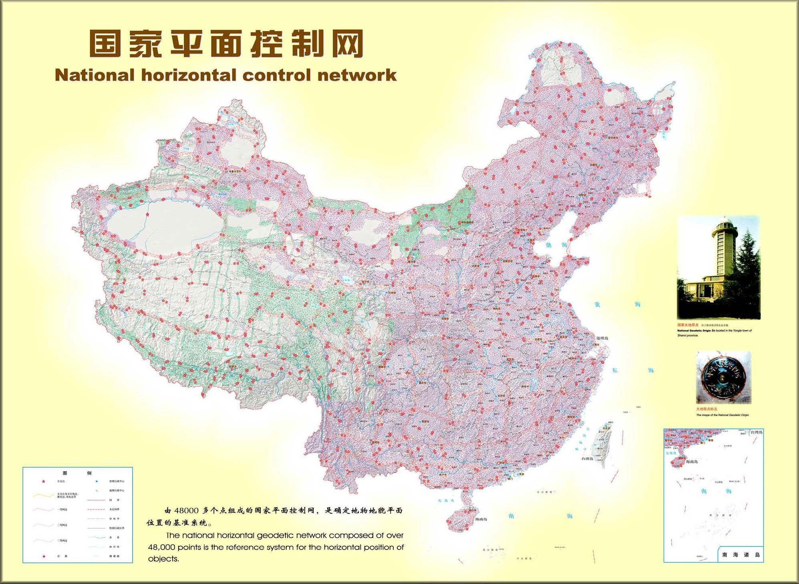
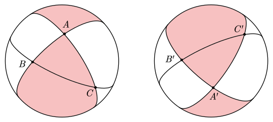
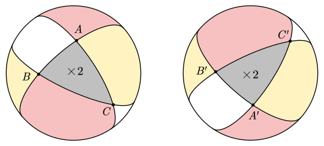
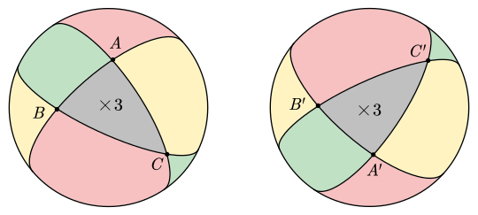

# 7 大地坐标计算

## 地面观测值归算

### 水平方向观测值归算

当仪器在测站点 $P_1$ 上对中置平后，仪器的纵轴就重合于 $P_1$ 的铅垂线。

1. 我们知道，地球质量实际上分布不均匀，与参考椭球存在差异，因此铅垂线不一定与椭球面法线重合，需要进行**垂线偏差改正**；
2. 经改正后，由于从点 $P_1$ 观测目标点 $P_2$ 的照准面与椭球面的交线（法截线）并不过 $P_2$ 的法线，因此也不过 $P_2$ 按法线方向在椭球面上的投影 $P_2'$，所以需要进行**标高差改正**；
3. 最后由对向观测的相对法截线方向需进行**归算到大地线方向的改正**。

共有三项改正，因此常称为**三差改正**。

#### 垂线偏差改正

在地面测站 $P_1$ 上所获得水平方向观测值是以垂线方向为准的。为得到以椭球面法线为准的水平方向观测值，需施加垂线偏差改正数：

$$
\delta_u=(\xi_1\sin A_{12}-\eta_1\cos A_{12})\cot z_{12}
$$

其中，$\xi_1,\eta_1$ 分别为测站 $P_1$ 上垂线偏差的子午分量和卯酉分量，$A_{12}$ 为该观测方向的大地方位角，$z_{12}$ 为对照准目标的天顶距。

经过垂线偏差改正后，点 $P_1$ 按椭球面法线方向在椭球面上的投影点 $O_1'$ 就可作为水平方向的起点。**以往仅在国家一、二等控制网中，才规定施加该项改正**。

#### 标高差改正

记 $P_1,P_2$ 按各自法线方向在椭球面上的投影点为 $P_1',P_2'$。则测站 $P_1$ 的照准面通过法线 $P_1P_1'$，是法截面。[上一节](./6-法截弧与大地线) 中我们已经提到过，$P_1P_1'$ 和 $P_2P_2'$ 两条法线通常是异面的，过 $P_1P_1'$ 的法截面通常不会过 $P_2P_2'$。因此，当仪器瞄准 $P_2$ 时，实际测的 $P_1P_2$ 与所需的 $P_1'P_2'$ 存在偏差。此项改正主要与目标点的大地高有关，因此常称为标高差改正。计算公式为

$$
\delta_h=\frac{H_2e'^2}{2M_2}\sin2A_{12}\cos^2B_2
$$

式中，$B_2,M_2$ 分别为照准点 $P_2$ 的大地纬度和子午线曲率半径。

#### 法截线方向归算到大地线方向的改正

该项改正数为：

$$
\delta_g=-\frac{S^2}{12N_1^2}e'^2\cos B_1\sin2A_{12}
$$

式中，$B_1,N_1$ 分别为在测站点 $P_1$ 的大地纬度及卯酉线曲率半径，$S$ 为点 $P_1'$ 和 $P_2'$ 间的大地线长度。**实际上此项改正甚小，即使是国家一等网，实际计算中也仅对边长大于 $30\operatorname {km}$ 的观测方向予以顾及**。

### 距离观测值归算

距离观测值归算是将地面观测得到的两个测站之间的距离值 $D$，换算成这两个测站在椭球面上对应点之间的大地线长度 $S$。

使用法截弧长度近似替代大地线长度，再用以平均法截弧曲率半径对应的圆弧长度近似替代法截弧长度，可以得到距离归算公式：

$$
S=\sqrt{D^2-(H_2-H_1)^2}\left(1-\frac{H_m}{R_A} \right)+\frac{\left[D^2-(H_2-H_1)^2 \right]^{3/2}}{24R_A^2}
$$

其中，$R_A$ 可取地球平均半径 $6371\operatorname {km}$，$H_m=(H_1+H_2)/2$。对于 $10\operatorname {km}$ 以内的边长，公式右侧第二项的大小不超过 $1\operatorname {mm}$，通常略去。

> 平面控制网国家一等天文大地锁网，在全国范围内大致沿经线和纬线方向布设，形成间距约 $200\operatorname{km}$ 的格网，三角形的平均边长约 $20\operatorname {km}$。
>
> 

## 椭球面上三角形的解算

### 球面角超的定义与计算

定义**球面角超**为球面三角形中的三个球面角 $\alpha,\beta,\gamma$ 之和超过 $\pi$ 的部分。

$$
\varepsilon=(\alpha+\beta+\gamma)-\pi
$$

这里球面三角形的三条边都是大圆的弧，大概长成下面这个样子。

<<< ./images/sphere-triangle.ggb

我们来推导球面角超与三角形面积的关系。设球面三角形的面积为 $F$，三个角为 $\alpha,\beta,\gamma$，三个顶点为 $A,B,C$，顶点关于球心的对称点为 $A',B',C'$。

考虑大圆弧 $\overset\frown{AB}$ 和 $\overset\frown{AC}$ 在球面上围成的部分，它形似两个月牙形，一头是 $A$，另一头是 $A'$。$AA'$ 过球心 $O$，由于中心对称性，两个月牙的面积应该各自是整个球的表面积的 $\alpha/2\pi$ 倍。我们将其涂成红色。

设单个月牙形面积为 $F_\alpha$，则有：

$$
F_\alpha=4\pi R^2\frac{\alpha}{2\pi}=2R^2\alpha
$$

同理再考虑 $\overset\frown{BA}$ 和 $\overset\frown{BC}$ 围出的两个月牙形，我们将其涂成黄色。注意这里的两个三角形（初始的球面三角形 $ABC$ 和它关于球心的对称 $A'B'C'$）被涂了两遍。

同理，这里黄色的单个月牙面积为：

$$
F_\beta=4\pi R^2\frac{\beta}{2\pi}=2R^2\beta
$$

继续考虑 $\overset\frown{CA}$ 和 $\overset\frown{CB}$ 围成的两个月牙形，将其涂成绿色。此时两个三角形已经被涂了三遍。

同理有绿色的单个月牙面积为

$$
F_\gamma=4\pi R^2\frac{\gamma}{2\pi}=2R^2\gamma
$$

这时候整个球的所有表面都已经被涂到过了。如果将三次涂色、6 个月牙形的面积相加，结果就应该是整个球的面积再补 4 个三角形面积（两个三角形各涂了 3 次，多涂了 2 次）。所以有

$$
\begin{aligned}
2F_\alpha+2F_\beta+2F_\gamma&=4\pi R^2+4F \\
4R^2(\alpha+\beta+\gamma)&=4\pi R^2+4F \\
\alpha+\beta+\gamma-\pi&=\frac F{\pi R^2}
\end{aligned}
$$

最后一个式子正是球面角超 $\varepsilon$。所以有

$$
\varepsilon=\alpha+\beta+\gamma-\pi=\frac F{\pi R^2}
$$

对于地球球面上边长小于 $40\operatorname {km}$ 的小三角形，也可以使用下面的近似公式计算：

$$
\varepsilon=\frac1{2R^2}ab\sin C
$$

### 解算球面三角形的勒让德定理

勒让德定理：对于较小的球面三角形，可用平面三角形公式来解算球面三角形，只须使三平面角等于相应的球面角减去三分之一的球面角超，而两者的边长仍保持相同。

$$
\frac{\sin(A-\varepsilon/3)}a=\frac{\sin(B-\varepsilon/3)}b=\frac{\sin(C-\varepsilon/3)}c
$$

这里不证。

当球面三角形的边长不超过 $200\operatorname {km}$ 时，球面高阶改正数的数值小于 $0.000\,5''$，已足够满足大地测量的应用需要。

## 大地主题解算

对于椭球面上的 $P_1,P_2$ 两点，设它们在大地坐标系中的大地经纬度分别为 $(B_1,L_1)$ 和 $(B_2,L_2)$，两点间的大地线长度为 $S$，正反大地方位角分别为 $A_{12},A_{21}$。这些量之间存在着确定的关系，可以从一些量推求另一些量，这称为**大地主题解算**。

由已知的点 $P_1$ 大地坐标 $(B_1,L_1)$、点 $P_1$ 至 $P_2$ 的大地线长度 $S$、大地方位角 $A_{12}$，解求点 $P_2$ 的大地坐标 $(B_2,L_2)$ 和反方位角 $A_{21}$，这称为大地主题正算。

由两点已知的大地坐标 $(B_1,L_1)$ 和 $(B_2,L_2)$ 来解求其间的大地线长度 $S$ 与正反大地方位角 $A_{12},A_{21}$，则称为大地主题反算。

一般地，对于中短距离的解算，按级数展开采用高斯平均引数公式。对于长距离的结算，使用贝塞尔公式。

我们介绍高斯平均引数正反算公式。其核心思路是：将大地线上任一点的大地坐标 $B,L$ 和大地方位角 $A$，视作从 $P_1$ 点起算的大地线弧长 $S$ 的函数。假定 $M$ 是大地线弧长中点，将起始点的经纬度和大地方位角用 $M$ 点经纬度值为参考点按泰勒级数展开。

### 高斯平均引数正算公式

$$
\begin{aligned}
b=B_2-B_1=\frac{V_m^2S\cos A_M}{N_m}\left\{1+\frac{S^2}{24N_m^2}\right.&[\sin^2A_m(2+3t_m^2+2\eta_m^2) \\
&\;+3\eta_m^2\cos^2A_m(-1+t_m^2-\eta_m^2-4t_m^2\eta_m^2) ] \} \\
\end{aligned}
$$

$$
\begin{aligned}
l=L_2-L_1=\frac{S\sin A_m}{N_m\cos B_m}\left\{1+\frac{S^2}{24N_m^2}\right.&[\sin^2A_mt_m^2 \\
&\;-\cos^2A_m(1+\eta_m^2-9t_m^2\eta_m^2) ] \}
\end{aligned}
$$

$$
\begin{aligned}
a=A_2-A_1\pm\pi=\frac{t_mS\sin A_m}{N_m}\left\{1+\frac{S^2}{24N_m^2}\right.&[\sin^2A_m(2+t_m^2+2\eta_m^2) \\
&\;+\cos^2A_m(2+7\eta_m^2+9t_m^2\eta_m^2+5\eta_m^4) ] \}
\end{aligned}
$$

其中，

- $B_m=\dfrac{B_1+B_2}2$
- $L_m=\dfrac{L_1+L_2}2$
- $A_m=\dfrac{A_1+A_2}2$
- $t_m=\tan B_m$
- $\eta_m=\sqrt{e'^2\cos^2B_m}$
- $V_m=\sqrt{1+e'^2\cos^2B_m}$

因此需要迭代。以上三式具有 4 次方精度，可用于解算 $200\operatorname {km}$ 下的大地主题。

### 高斯平均引数反算公式

$$
S\cos A_m
=
\frac{bN_m}{V_m^2}
-
\frac{N_m\cos^2 B_m(2+3t_m^2-3t_m^2\eta_m^2)}{24}bl^2
-
\frac{N_m}{8}(t_m^2\eta_m^2-\eta_m^2)b^3
$$

$$
S\sin A_m
=
N_m\cos B_m l
+
\frac{N_m\cos B_m}{24}
(1-\eta_m^2-9t_m^2\eta_m^2)b^2l
-
\frac{N_m\cos B_m\sin^2 B_m}{24}l^3
$$

$$
A_m
=
\tan^{-1}
\frac{S\sin A_m}{S\cos A_m}
\qquad
S
=
\frac{S\sin A_m}{\sin A_m}
$$
