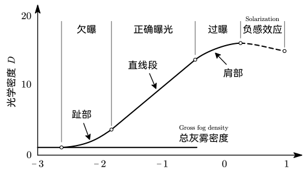
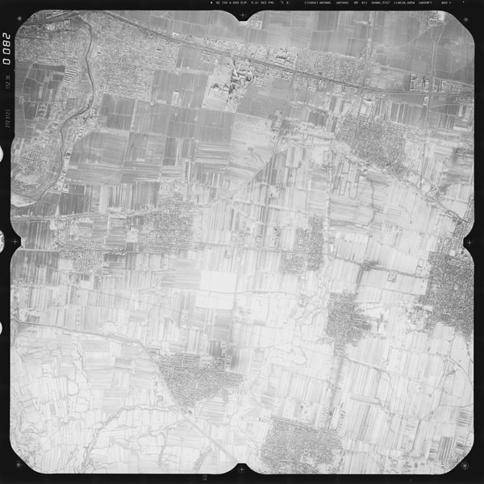
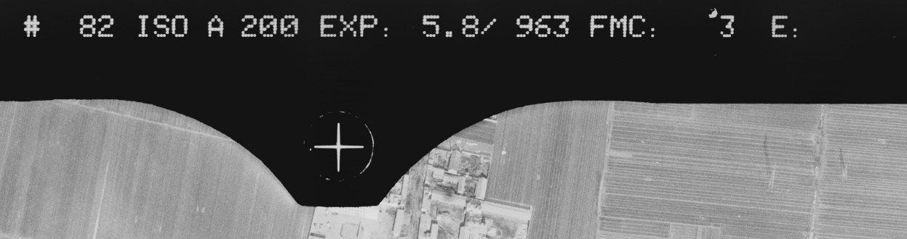
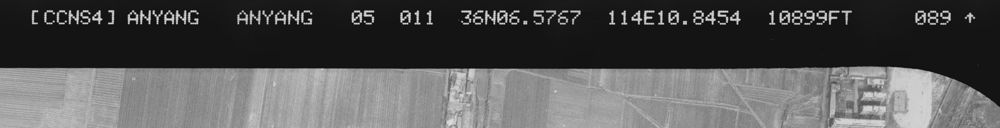
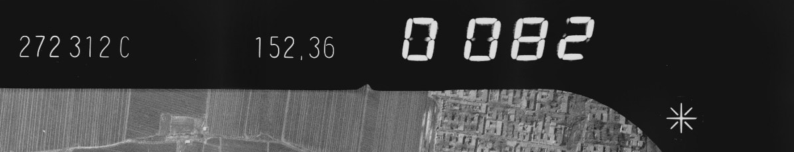
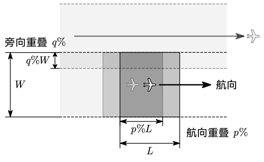
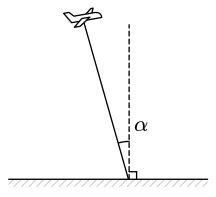
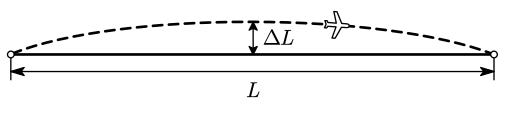
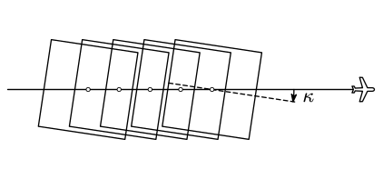

# 2 量测相机与航空摄影

## 光学与成像基础

### 焦距、像距、主距

真实镜头具有厚度，不便处理，因此建立理想物理模型：薄透镜。薄透镜成像满足：

$$
\frac1p+\frac1q=\frac1f
$$

其中 $p$ 为物距，$q$ 为像距。物距趋于无穷远时，像距趋近于焦距。真实镜头具有厚度，但是可以建立等效薄透镜模型。

这个公式就是初中物理中「一焦分虚实、二焦分大小」「物在大区像在小区、物在小区像在大区」等定性口诀的定量描述。具体来说，基于这个公式，取 $f=1$，$x$ 为 $p$，$y$ 为 $q$，绘出图像：

```graph
{
  data: [
    {
      graphType: "polyline",
      fn: "1/(1-1/x)",
      range: [1, Infinity],
    },
  ],
  annotations: [
    { y: 1 },
    { y: 2 },
    { x: 1 },
    { x: 2 },
  ],
  center: [2, 2],
}
```

当物距 $p>2f$ 时，像距 $q$ 满足 $f<q<2f$。对于我们常用的近景相机（例如手机相机），拍摄时物距会变化，因此像距需要随之改变，即「对焦」。但是对于航摄相机，镜头离地面很远，$p\to\infty$ 时 $q\to f$，像距与焦距近似相等。因此航摄像机一般出厂时直接将感光元件与摄影中心的距离定为焦距 $f$，不能调节。

==定义**主距**为是从摄影中心沿主光轴量至像平面的距离。所以航摄相机中，主距等于像距等于焦距，均使用字母 $f$==。

### 光圈与景深

光圈孔径的直径记为 $D$，它决定镜头的进光量。相对孔径与 $D/f$ 有关，常用光圈值逐级按约 $\sqrt 2$ 的比例变化。摄影测量相机通常采用视场较大的镜头，增大影像光线束的交会角有利于提高空间交会的几何强度。

定义==景深==：在聚焦完成后，焦点前后的范围内所呈现的清晰图像的距离。

==景深与光圈的关系==：光圈越小（光圈号数越大），景深越大。

==景深在摄影测量中的意义==：对于航空摄影测量，物体和相机距离较大，大于超焦点距离，成像都是清晰的，不用考虑景深问题。对于近景摄影测量，需要考虑景深的问题。

### 透镜像差与畸变

畸变是透镜像差的一种。

==物镜畸变的种类==：物体畸变分为径向畸变、切向畸变。在摄影测量中，主要是处理径向畸变，由于量测用相机的焦距是不变的，所以像片所产生的切向畸变的误差量级可以忽略。对于径向畸变而言，一般可以采用查表的方法或者通过奇次多项式函数进行改正。

径向畸变修正量的经验公式：

$$
d_r=k_1r^3+k_2r^5+k_3r^7+\cdots
$$

切向畸变也称偏心畸变，通常由镜头组件装配误差引起。除畸变外，其他像差主要影响影像质量，通常由镜头设计尽量减小。透镜像差还包括球差、彗差、像散和色像差等。

### 感光材料、快门与曝光

胶片由感光乳剂层、片基和防晕层等组成。乳剂中的卤化银颗粒受光后形成潜影，显影后形成影像。片基在曝光和处理过程中不能发生明显变形，否则会破坏影像几何关系。感光速度较快的胶片通常含有较大、较少的颗粒，所成影像的分辨率较低，放大时颗粒感更明显。

胶片可分为负片和反转片。负片的明暗关系与景物相反，反转片可以直接得到正像。通过改变乳剂的光谱敏感范围，可以得到正色、全色和近红外敏感的感光材料。

**感光特性曲线**（H-D 曲线）描述影像密度与曝光量之间的关系。



曲线的趾部对应曝光不足，肩部对应曝光过度。==为了正确恢复景物反差，摄影时景物的曝光量值应该落在感光特性曲线的**中段**==。

> 曝光量满足
>
> $$
> H=Et
> $$
>
> 其中 $E$ 为照度，$t$ 为曝光时间。若以透射光与入射光之比定义透射率 $T$，则密度为
>
> $$
> D=\log_{10}\frac1T
> $$

==假彩色影像的定义==：假彩色影像是对真实影像赋予假色彩而合成的影像。即通过映射函数将多光谱影像的波段赋予新的 RGB 值，如 NIR→红，红→绿，绿→蓝。

> [!note]
>
> **==航空摄影测量为什么要选择中心快门相机，对于动态变形检测或室内 SLAM 工作选择缝隙式滚动快门是否可以，为什么==**
>
> - 中心快门相机可以同时曝光整个图像，并且速度较快，适合航空摄影测量在移动平台上拍照的要求。
> - 不可以选用滚动快门，在物体快速移动时，会造成图像产生变形，会影响立体几何计算。

## 量测用相机

### 量测用相机的特点

主距：摄影机物镜后节点到像片主点的垂距。航空摄影时，物距可视为无穷远，像距几乎等于物镜焦距。故将物镜固定调焦于无穷远处，主距等于物镜焦距，均使用 $f$ 表示。

框标：胶片时代，在固定不变的承片框上，安置四个边的中点的标志。其目的是建立像片的直角框标坐标。两两相对的框标连线成正交，其交点成为像片平面坐标系的原点，从而使摄影的像片上构成直角框标坐标系。

==**量测用相机的特性**==：

- 像距固定不变是主距（几乎等于物镜焦距）
- 像片上有框标（数字形式隐含）
- 内方位元素已知
- 畸变小
- 结构精密
- 需同时曝光等

### 框幅式航摄相机的构造与检校

标准框幅式航摄相机主要由镜头、快门、暗盒和镜箱组成。镜头需要在整个像幅内具有高分辨率、很小的畸变和较好的色差校正；像平面上还可以记录框标、相片编号、时间、日期、航高和相机编号等数据。

::: details 航摄像片举例

如下是一张典型的航摄像片：



可以看到四个角点与四边中点均存在框标，呈十字形。顶部中间放大图：



顶部右侧放大图中可以看到是项目 `ANYANG` 的 `ANYANG` 分区，第 5 航线第 11 片：



左侧放大图：



:::

摄影机支架用于隔离振动并控制相机的姿态和航向。横风会使飞机机头方向与实际飞行方向不一致，若相机随飞机机身而没有随实际航线方向调整，就会产生像片旋转，降低有效覆盖宽度。

相机检校包括几何检校和影像质量检验。几何检校用于确定内方位元素和畸变等参数，影像质量检验用于确认相机成像是否达到设计要求。现代航空摄影系统一般组合使用航摄相机、GPS、IMU、导航控制系统和相机支架。

### 数字传感器与影像质量

从胶片（模拟）时代迈入数字时代后，光电传感器把入射光转换为电信号。CCD 是典型的半导体传感器，像元尺寸会影响集光能力和影像分辨率。入射光子转换为电子的比例称为量子效率。与入射光无关、并且受温度影响的噪声电流称为暗电流。

影像质量主要关注空间分辨率、地面采样间隔（GSD）、反差、曝光、清晰度和噪声。实际航空摄影还需要检查云、云影、烟、大面积反光和污点等影像缺陷。

### 传感器与摄影平台

被动传感器记录场景反射或发射的能量，主动传感器主动发射能量并接收回波。雷达是典型的主动传感器，通过发射微波并利用反射能量估计目标的距离和方向。

按传感器的空间采样方式，成像几何可分为点传感器、线阵成像和面阵（框幅式）成像。推扫式传感器使用线阵逐行获取影像，框幅式相机在一次曝光中获取完整影像幅面。

> 本课程主要关注传统的被动、框幅式成像处理。有关其他平台的处理，见 [遥感原理与应用](../遥感原理与应用/) 课程笔记。

摄影测量平台包括无人平台、航空平台和卫星平台。无人平台包括风筝、飞艇、气球以及遥控飞机等，适合局部区域的小幅面摄影。

## 航空摄影

### 摄影比例尺与航高

**摄影比例尺** $\dfrac1m$ 定义为航摄像片上一线段为 $l$ 的影像与地面上相应线段的水平距离 $L$ 之比，即有 $\dfrac1m=\dfrac lL$。

**摄影航高** $H$ 定义为摄影机的物镜中心至摄区的平均高程面（摄影基准面）的距离。

数量关系满足：

$$
\frac1m=\frac lL=\frac fH
$$

其中 $f$ 为摄影机主距。

当选定了摄影机和摄影比例尺后，即 $f$ 和 $m$ 为已知，航空摄影时就要求按计算的航高 $H$ 飞行摄影，以获得符合生产要求的摄影像片。

### 摄影资料参数

**航向重叠**：同一条航线上相邻两像片的重叠比例。

**旁向重叠**：相邻航线的重叠比例。



**像片倾角** $\alpha$：摄影瞬间，摄影机轴与铅直方向的夹角。



**航摄最大偏距**：航向弯曲时，实际航线与目标航线的最大偏移距离。



**像片旋角** $\kappa$：相邻像片的主点连线与像幅沿航线方向两框标连线间的夹角。



### 摄影资料的要求

==**航空摄影的基本要求**==：

- 飞行质量要求：航向重叠、旁向重叠、航高差、航向弯曲、旋片角；
- 影像质量要求：反差正常，灰度正常，影像上地表信息缺失的部分较少。

==**传统航空摄影测量对空中摄影形式的要求**==：

- 合适的摄影比例尺
- 相对航高差 $\dfrac{\Delta H}H<5\%$
- 航向重叠 $p>60\%$，旁向重叠 $q>30\%$（航向、旁向重叠小于最低要求时，称航摄漏洞）
- 航线弯曲 $\dfrac{\Delta L}L<3\%$
- 旋片角 $\kappa<6\%$
- （主光轴竖直等）

==**为什么要有重叠度**==：

- 重叠区覆盖整个测区（立体测图的需要）
- 防止出现摄影漏洞（这样就不能用于测图）
- 在解析空中三角测量时用于连接相邻模型，补充性的地面控制

摄影平台运动且曝光时间不为零时，影像会产生像移并表现为模糊。竖直摄影、地面近似水平时，像平面上的影像速度可近似写为

$$
v_i=\frac fH v
$$

其中 $v$ 为平台速度，$f$ 为主距，$H$ 为航高。可以通过缩短曝光时间或进行像移补偿减小模糊。

## 中英术语对照

::: details 对照表

| 英文术语                           | 中文术语     |
| ---------------------------------- | ------------ |
| cartographic aerial camera         | 航摄相机     |
| metric camera                      | 量测用相机   |
| fiducial mark                      | 框标         |
| collimated light                   | 准直光线     |
| radial distortion                  | 径向畸变     |
| tangential distortion              | 切向畸变     |
| sidelap                            | 旁向重叠     |
| forward overlap                    | 航向重叠     |
| principal distance                 | 主距         |
| focal length                       | 焦距         |
| principal point of autocollimation | 自准直主点   |
| fiducial center                    | 框标中心     |
| thin lens                          | 薄透镜       |
| principal plane                    | 主平面       |
| nodal point                        | 节点         |
| aperture                           | 光圈         |
| relative aperture                  | 相对孔径     |
| f-stop                             | 光圈值       |
| field of view                      | 视场         |
| lens aberration                    | 透镜像差     |
| decentering distortion             | 偏心畸变     |
| photographic film                  | 摄影胶片     |
| emulsion                           | 感光乳剂     |
| latent image                       | 潜影         |
| negative film                      | 负片         |
| reversal film                      | 反转片       |
| sensitometry                       | 感光学       |
| characteristic curve               | 感光特性曲线 |
| exposure                           | 曝光量       |
| CCD                                | 电荷耦合器件 |
| ground sample distance             | 地面采样间隔 |
| pushbroom sensor                   | 推扫式传感器 |
| frame camera                       | 框幅式相机   |
| image motion compensation          | 像移补偿     |
| global shutter                     | 全局快门     |
| rolling shutter                    | 滚动快门     |
| camera calibration                 | 相机检校     |
| passive sensor                     | 被动传感器   |
| active sensor                      | 主动传感器   |
| radar                              | 雷达         |
| unmanned platform                  | 无人平台     |
| inertial measurement unit          | 惯性测量单元 |

:::

## 小测问题

- 量测用相机有哪些特性？
- 物镜畸变的种类，在摄影测量中如何处理？
- 传统航空摄影测量对空中摄影的形式有哪些要求？
- 航空摄影测量为什么要选择中心快门相机，对于动态变形检测或室内 SLAM（simultaneous localization and mapping，即时定位与地图构建）工作选择缝隙式滚动快门是否可以，为什么？
