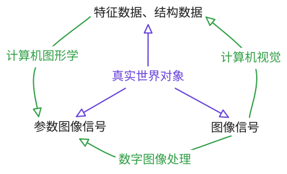
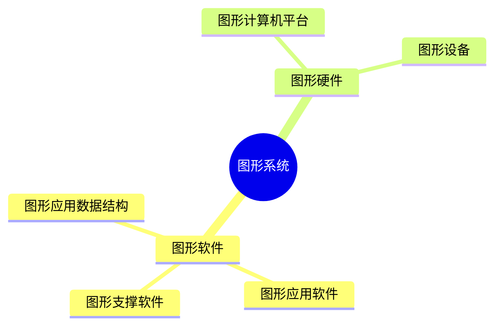

# 1 绪论

## 计算机图形学的定义

**定义**：研究利用计算机及其图形设备，对图形进行输入、表示、建模、变换、运算、存储和输出的一门学科。

**ISO 定义**：研究用计算机进行数据和图形之间相互转换的方法和技术的学科。

**核心问题**：如何将数据转化为图形，以及如何在计算机中处理这些图形。

**研究内容**：

1. 图形的表示与建模：如何在计算机中描述和存储图形对象；
2. 图形的生成：如何将几何模型转换为屏幕上的像素表达，即基本图元（直线、圆弧、多边形、曲线等）的生成算法；
3. 图形的变换：如何对图形进行平移、旋转、缩放等几何操作；
4. 图形的裁剪：如何在指定的窗口区域内显示图形的可见部分；
5. 真实感图形绘制：如何模拟光照、材质、纹理等效果，生成逼真的图形；
6. 人机交互技术：如何实现用户与图形系统之间的高效交互。

## 图形与图像

- 图形（矢量图形）：由几何图元（如点、线段、圆弧、多边形、曲线等）及其属性（颜色、线型、填充方式等）构成的数学描述，存储的图元的几何参数和渲染指令。
  - 特点：缩放不失真、存储体积小、便于编辑修改、适合面向对象的操作
  - 典型格式：DXF、DWG、SVG、AI 等
- 图像（栅格图像）：由像素矩阵构成的数字画面，存储是逐行逐列的像素数据
  - 特点：分辨率固定、缩放时可能失真（出现锯齿或模糊）、存储体积较大、适合表现连续色调的复杂场景
  - 典型格式：BMP、JPEG、PNG、TIFF 等

## 计算机图形学与相关学科

计算机图形学关注的是从模型到图形图像的过程（即「合成」），以几何模型为输入，输出图像。

### 与数字图像处理

数字图像处理关注从图像到图像的变换（如增强、滤波、分割等），以图像为输入，输出处理后的图像。两者的交汇点在于可视化领域，例如将图像处理的结果叠加在几何图形上。

### 与计算机视觉

计算机视觉关注从图像到模型的过程（即「理解」），如从图像中提取三维几何信息。与计算机图形学构成「逆问题」关系——图形学是从模型→图像，视觉是从图像→模型。近年来，基于三维重建和深度学习的技术将二者紧密联系在一起。

### 与图学理论

图学理论（画法几何与工程图学）为计算机图形学提供了投影变换、视图表达等基础理论，而计算机图形学为传统图学提供了自动化和智能化的实现手段。

### 与 CAD/CAM

CAD（计算机辅助设计）是计算机图形学最重要的应用领域之一。CAD 系统以图形学算法为内核，为用户提供交互式的产品设计与建模环境。本课程以 AutoCAD 这一广泛使用的 CAD 平台为载体，讲授计算机图形学的核心算法及其实现。

## 图形系统的组成与功能

### 图形硬件系统

- 计算与处理核心
  - CPU 负责逻辑控制与通用计算
  - GPU 负责图形渲染的并行计算（数千核心）
    - 显卡集成显存（VRAM），用于存储纹理、帧缓冲等图形数据
- 图形输入设备：键盘、鼠标、数字化仪 / 数位板、扫描仪、三维扫描仪
  - 特殊交互设备：触摸屏、操纵杆、数据手套等
- 图形显示设备： LCD 、 OLED 显示器与投影设备
  - 关键性能指标：分辨率、刷新率、色域覆盖范围、响应时间
  - 三维显示：立体显示器、头戴式显示设备（VR 头盔、VR 眼镜）
- 图形输出设备：激光 / 喷墨 / 热敏打印机、笔式 / 喷墨绘图仪
  - 宽幅绘图仪是生产纸质地形图的关键设备
  - 3D打印机的普及为三维数字化模型的实体化提供了新的途径

### 图形软件系统

- 图形数据的定义与建模
  - 二维：点、线、圆、圆弧、椭圆、多边形、样条曲线
  - 三维：线框模型、表面模型和实体模型
- 图形变换与编辑：移动、旋转、缩放、镜像、阵列、修剪、延伸、倒角
- 图形显示控制
  - 窗口-视口变换：确定图形的显示范围和比例
  - 视图操作：缩放、平移、旋转视角
  - 图层管理：控制图形的可见性和显示顺序
  - 线型和颜色设置
- 图形数据
  - 文件读写
  - 图形数据库
  - 外部参照与数据链接
  - 空间数据组织与维护
- 用户交互接口
  - 命令行界面
  - 图形用户界面：菜单、工具栏、对话框、属性面板等
  - 辅助绘图工具：对象捕捉、极轴追踪、动态输入等
- 二次开发接口

## 杂项

### 计算机图形学的应用领域

- 计算机辅助设计与制造（CAD/CAM）
- 地理信息系统（GIS）与遥感（RS）
- 科学计算可视化
- 虚拟现实（VR）与增强现实（AR）
- 计算机艺术与动画

### 计算机图形学的研究动态

- 真实感图形与实时光线追踪
- 基于深度学习的图形生成
- 三维重建与点云处理
- 地理空间智能可视化
