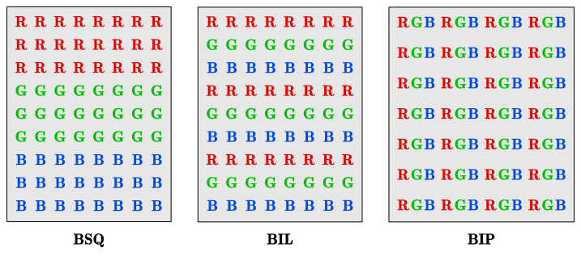

# 6 遥感图像的几何处理

## 图像的表示形式

采样：连续的图像在坐标空间的离散化。

量化：图像在性质空间（灰度）的离散化。

空间分辨率：连续图像在水平和垂直方向的采样距离，对应采样的精度。

亮度分辨率（灰度等级）：图像亮度层次的多少，用灰度级 $L=2^k$ 表示，对应量化的精度。当一幅图像有 $L=2^k$ 灰度级时，称该图像是 $k$ 比特（bit）图像。

伪彩色：一种对灰度影像的增强方法。将灰度图像分为若干个灰度区间，将不同灰度区间映射为一种颜色，从而使得肉眼能够更好地辨别图像中的不同地物类别。

假彩色合成：根据加色或减色法，将多波段单色影像合成为一幅影像的技术。合成彩色影像通常与天然色彩不同，且可以任意变换。

彩红外影像：遥感影像中常用的一种假彩色合成影像。依次将景物反射的绿、红、近红外光映射到蓝、绿、红三个通道上得到的彩色影像。其中的植被会呈现明显的红色。

真彩色合成：合成图像的红绿蓝三个多光谱完全对应时，图像就再现了地物的彩色。

## 遥感图像格式

### LTWG

Landsat Technical Working Group 提出了 LTWG 格式，即世界标准格式。1982 年以后包括陆地卫星、法国 SPOT 等卫星遥感数据都采用了世界标准格式。LTWG 格式有 BSQ 和 BIL 两种。

由于多波段影像有行、列、波段三个维度的数据，而数据存储是一维的。因此需要考虑如何排列数据。

- Band sequential (BSQ)：按波段依序记录各波段图像，波段 - 行 - 列
- Band interleaved by line (BIL)：逐行按波段顺序交叉排列，行 - 波段 - 列
- Band interleaved by pixel (BIP)：逐像素按波段顺序排列，行 - 列 - 波段

### GeoTIFF

GeoTIFF 在 TIFF 的基础上定义了一些地理标签 GeoTag，可实现对各种坐标系统、椭球基准、投影信息等进行定义和存储，使得图像数据和地理数据存储在同一图像文件中。

GeoTIFF 图像数据常配套存放一些额外文件，用于存储地理配准、投影、元数据等信息：

- `.tfw` Tiff World File：提供图像左上角坐标及像素分辨率信息，用于将像素坐标转换为地理坐标；
- `.xml` 元数据文件：存储 GeoTIFF 的元数据，如坐标系、投影参数、来源说明等；
- `.aux` 辅助文件：存储投影参数、地理参考点等，用于快速加载或验证 GeoTIFF 的地理信息；
- `.ovr` 金字塔文件：用于多分辨率显示，提升加载速度。

## 遥感图像的几何变形

定义：遥感图像的几何变形是指图像上各地物的几何位置、形状、尺寸、方位等特征在图像坐标系中的坐标与其在地图坐标系等参考坐标系统中的对应坐标之间的差异。

### 变形误差分类

静态误差和动态误差：

- 静态误差是在成像过程中，传感器相对于地球表面呈静止状态时所具有的各种变形误差。
- 动态误差主要是在成像过程中由于地球的旋转等因素所造成的图像变形误差。

内部误差和外部误差：

- 内部误差主要是由于传感器自身的性能技术指标偏移标称数值所造成的。
- 外部变形误差是在传感器本身处在正常工作的条件下，由传感器以外的各种因素所造成的误差，如传感器的外方位元素变化，传感器介质不均匀，地球曲率，地形起伏以及地球旋转等因素引起的变形误差。

### 变形误差举例

- 传感器成像方式引起的图像变形
- 传感器外方位元素变化的影响
- 地形起伏引起的像点位移
- 地球曲率引起的图像变形
- 大气折射引起的图像变形
- 地球自转的影响

## 遥感图像的几何处理

### 遥感图像的粗加工处理

- 投影中心坐标的测定和解算
- 传感器姿态角的测定
- 扫描角 $\theta$ 的测定

### 遥感图像的精加工处理

遥感图像的精校正是指消除图像中的几何变形，产生一幅符合某种地图投影或图形表达要求的新图像的过程。它包括两个环节：一是像素坐标的变换；二是对坐标变换后的像素亮度值进行重采样。常用的纠正方法有多项式法（亮度灰度重采样），共线方程法，有理函数法等。

## 图像间的自动配准和数字镶嵌

### 图像配准过程

- 在图像上确定足够数量且分布均匀的同名点
- 通过所选择同名点解算几何变换的多项式参数，完成几何配准
- 基于局部特征描述 —— SIFT：尺度不变、旋转不变特征
  1. 构建尺度空间
  2. 找关键点 DOG 近似 LOG
  3. 去除不好的特征点
  4. 给特征点赋方向参数
  5. 特征点描述子的生成
  6. 向量归一化
  7. 旋转到主方向

### 基于小面元微分纠正的图像间自动配准

- 图像特征点提取
- 预处理
- 粗匹配
- 几何条件约束的整体松弛匹配
- 小面元微分纠正

### 数字图像镶嵌

- 图像的几何纠正
- 搜索镶嵌边
- 亮度和反差调整
- 平滑边界线

基于小波变换的图像镶嵌可以很好地兼顾图像清晰度和光滑度。
