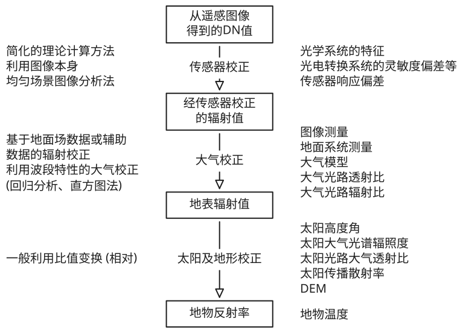

# 7 遥感影像的辐射处理

遥感图像的辐射误差主要包括：

- 传感器本身性能引起的辐射误差
- 地形影响和光照条件变化引起的辐射误差
- 大气的散射和吸收引起的辐射误差

相应的辐射处理包括**传感器辐射定标**和**辐射误差校正**等。

## 传感器辐射定标

DN 值（Digital Number）：遥感影像中每个像元的灰度数值，表示传感器接收到的辐射信号经量化后的整数。

辐射定标（目的）：建立遥感传感器的数字量化输出值 DN 与其对应视场中辐射亮度值间的定量关系。

意义：传感器定标是遥感信息定量化的前提，遥感数据的可靠性及应用的深度和广度取决于遥感器的定标精度。

手段：测定传感器对一个已知辐射目标的响应。

内容：强度定标（主要）、光谱定标、空间定标。

辐射定标又分为相对定标和绝对定标。

### 绝对定标

绝对定标：**对目标作定量的描述，得到目标的辐射绝对值**。

绝对定标要建立传感器测量的数字信号（DN 值）与对应的辐射能量之间的数量关系，即定标系数，在卫星发射前后都要进行。

卫星发射前的绝对定标是在地面实验室或试验场，用传感器观测辐射亮度值已知的标准辐射源以获得定标数据。

发射前的实验室定标是原始定标，准确度最高，随后各阶段的定标应在此原始数据上对比、修正；星上绝对定标也很重要，因为它直接反映了遥感器随卫星发射入轨运行的实际情况；辐射校正场是综合性定标，是在地面用多种方法对比的真实性检验，对前两项定标进行修正，是卫星上天后重要的定标方法。

#### 实验室定标

$$
L=A_L\times \mathrm{DN}+B_i
$$

其中 $L$ 为入瞳辐射值，$\mathrm{DN}$ 为传感器记录值，$A_i$ 为增益系数，$B_i$ 为偏置量。

#### 星上内定标

优点：可对一些光学遥感实时定标

不足：大部分只是部分系统定标；没有模拟遥感器的成像状态；星上定标系统也不够稳定。

#### 场地外定标

场地外定标是指遥感器在正常运行和外界环境条件下，通过同步测量来对遥感器定标的一种方法。遥感器飞越辐射定标场上空，在定标场选择若干靶标，测量遥感器对应的各波段地物的光谱反射率和大气光谱参量，与已知辐射值进行比较计算。

### 相对定标

相对定标：又称为传感器探测元件归一化，是**为了校正传感器中各个探测元件响应度差异，而对卫星传感器测量到的原始亮度值进行归一化**的一种处理过程。由于传感器中各个探测元件存在差异，使传感器探测数据图像出现一些条带。相对辐射定标的目的就是降低或消除这些影响。

## 遥感影像的辐射校正

遥感影像的辐射校正是指除或改正遥感图像成像过程中附加在传感器输出的辐射能量中的各种噪声的过程。

### 大气校正

#### 基于地面场地数据或辅助数据

将地面测定的结果与卫星图像对应像元的亮度值进行回归分析。

$$
L=a+bR
$$

#### 大气模型

需要有关大气假设或成像时刻的大气参数（气压、温度、水汽、臭氧等）、气体中的悬浮物类型，高度、太阳高度角、传感器的视角等。

> 大气辐射传输公式
>
> $$
> \begin{gathered}
> L=L_g\cdot T(\theta_V)+L_{d\uparrow} \\
> L_g=\frac\rho\pi E_0\cos\theta_S\cdot T(\theta_S)
> \end{gathered}
> $$
>
> 式中
>
> - $L$ 卫星入曈处接收的辐射亮度
> - $L_g$ 地表接收并反射的辐射亮度
> - $L_{d\uparrow}$ 大气透过率和由于大气散射造成的向上大气光> 谱辐射亮度，即程辐射或路径辐射
> - $\theta_V$ 遥感卫星天顶角
> - $\rho$ 地物表面反射率
> - $E_0$ 太阳常数
> - $\theta_S$ 太阳天顶角
> - $T(\theta_V)$ 观测方向的大气辐射总透过率
> - $T(\theta_S)$ 入射方向的大气辐射总透过率

#### 利用波段特性

- 回归分析法：在不受大气影响的波段和待校正的波段影像中，选择从最亮到最暗的一系列目标，对每一个目标两个波段进行回归分析，形成线性关系
- 直方图法

### 地形校正

- 太阳高度角引起的辐射畸变校正：将太阳光线倾斜照射时获取的图像校正为太阳光垂直照射时获取的图像；
- 日地距离引起的辐射畸变校正：将图像校正为标准化日地距离的图像；
- 地形影响引起的辐射校正：需要知道各坡面的倾角，需要已知该地区的 DEM。此外，可以通过比值图像来消除或比分减小其影响。

## 图像融合

定义：将多源遥感图像按照一定的算法，在规定的地理坐标系，将不同传感器获取的遥感影像中所提供的各种信息进行综合，生成新的图像的过程。

目的：提高对影像进行分析的能力（通过融合既提高多光谱图像空间分辨率，又保留其多光谱特性）。

多源遥感图像信息融合的关键：

- 对多源遥感数据做出合理的选择：波谱信息相关性——有用信息的增加、噪声误差的增加
- 影像精确配准：解决遥感影像的几何畸变问题，使各种遥感影像在空间位置上能精确配准
- 选择合理的融合算法：最大限度的利用多种遥感数据中的有用信息

图像融合可以分为若干层次。一般认为可分像素级，特征级和决策级。

### 像素级影像融合

1. 几何配准，影像重采样
2. 计算相关系数
3. 计算融合后像素值

### 特征级影像融合

- IHS 变换融合
  1. 几何配准，影像重采样
  2. 影像分别从 RGB 空间转换到 IHS 空间
  3. 高分辨影像的 I’分量与低分辨率影像的 I 分量做直方图匹配
  4. I’分量代替 I 分量
  5. I’HS 逆变换到 RGB 空间
- 主分量变换融合
  1. 几何配准，影像重采样
  2. 对低分辨率影像进行主成分变换
  3. 对高分辨率影像进行灰度拉伸，使其灰度均值 与方差与第一分量接近
  4. 用拉伸后影像代替第一分量
  5. 逆变换回多光谱影像

### 决策级影像融合

不同时相的分类后融合：先要对图像分类，在分类的基础上进行融合。

1. 对图像中的不同类别用不同波段或不同图像融合以达到增加空间特性和光谱特性；
2. 对不同时相的图像进行分类后融合，可以达到提取图像内变化信息的目的。

### 图像融合的效果评价

- 定性评价
  - 优点：简单、直接
  - 缺点：因人而异，具有主观性
- 定量评价
  - 平均梯度：$G$ 越大则图像层次越多，图像越清晰
  - 熵和联合熵：熵越大则图像包含的信息越丰富
  - 偏差指数、相关系数：交叉熵越小,表示图像间的差异越小
  - 融合后图像分类的精度：融合后图像与原始图像在光谱信息上的匹配程度
